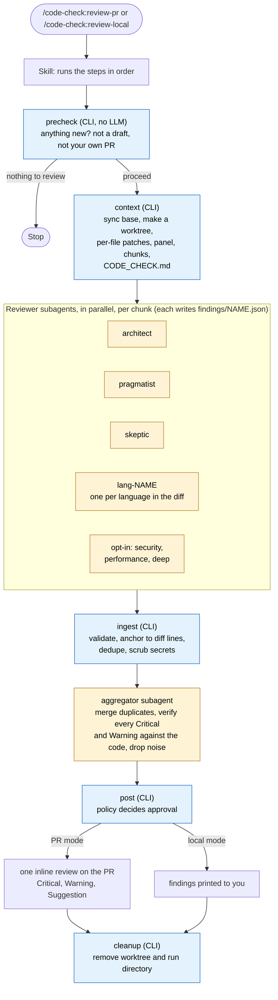
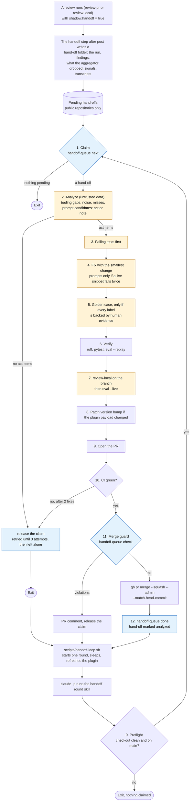

# code-check

Review code and deal with review comments on pull requests, from inside Claude Code.

`code-check` is a plugin with four skills on top of a deterministic Python CLI. Everything mechanical (git, the `gh` CLI, fetching and posting comments, diff anchoring, the approval policy, loop bookkeeping) is ordinary tested code. Agents are used only for judgment: reviewing code, weighing review comments, diagnosing CI failures, writing fixes.

| Skill | What it does |
|---|---|
| `review-local` | Reviews your own branch (committed and uncommitted) against the freshly fetched remote base and prints the findings. Never posts. |
| `review-pr` | Reviews a teammate's PR and posts one inline review. With no argument it works your review-requested queue, at most 5 PRs per run, one at a time. |
| `address-comments` | On your own PR: checks each unresolved thread critically, fixes what is valid, pushes back with evidence on what is not, pushes behind a test gate, replies, resolves fixed threads, re-requests review. |
| `babysit-pr` | `address-comments` plus failing CI checks, across your PRs, designed to run under `/loop`. |

Findings are **Critical**, **Warning** or **Suggestion** and are posted inline on the changed lines. A panel of reviewers works on each change: up to 15 language experts (only for languages present in the diff), an architecture reviewer, a pragmatic reviewer and a skeptic, with an optional slot for a "deep" reviewer backed by your own knowledge sources, an opt-in security reviewer (see [Security review](#security-review)) and an opt-in performance reviewer (see [Performance review](#performance-review)). An Opus aggregator verifies every Critical and Warning against the code before anything is posted.

```
precheck (no LLM) → fetch latest base → context → reviewer panel (parallel) → ingest → aggregator → post (inline) → shadow record
```

If there is nothing to review, the run stops after `precheck` and spends zero tokens. A PR we already reviewed is skipped until a new commit lands. Replies on our threads are reported but never trigger a review unattended; an interactive `review-pr <PR>` shows them and offers a re-review. In PR mode `context` also writes `existing-comments.md` into the run directory: every inline review thread already on the PR (ours and humans', resolved and outdated included, bots excluded, unresolved first, scrubbed and capped), with replies since our last review tagged `[new]` and our own earlier comments tagged `[ours]` (they are not a maintainer's position). Threads with new replies sort first, so the caps never cut them. Reviewers and the aggregator read it as untrusted data so they do not repeat or contradict what maintainers already said; the aggregator records suggestion-level repeats as dropped with the reason `already-raised` (critical and warning findings are never dropped for it, so the approve policy still sees them), and style findings that cite no project precedent as `unsupported-style`. `context` lists the optional files present in the run directory (`CODE_CHECK.md`, `existing-comments.md`) as `run_files`, and reports the comments as `existing_comments` (`threads`, `comments`, `new_replies`); if the comments cannot be fetched the review still runs and `existing_comments_error` says why. `--with-replies` is accepted for compatibility and has no extra effect. GitHub (our latest submitted review on the PR) is the source of truth for "already reviewed"; the local state record is only a shortcut, so a fresh machine does not re-review.

## Install

Prerequisites:

- Python **3.14.10 or later** (`doctor` warns below this, and the installer refuses to run on anything older than 3.14). `uv` is used if present.
- `git` and Claude Code.
- The CLI for your code host: the GitHub CLI `gh` (logged in with `gh auth login`) for GitHub, or the GitLab CLI `glab` (logged in with `glab auth login`) for GitLab. One is enough; install both if you work with both.

**Choosing a host.** By default (`provider = "auto"`) a repository whose `remote` points at `gitlab.com` uses GitLab and any other remote uses GitHub. Set `provider = "github"` or `"gitlab"` in the config to choose explicitly; self-hosted GitLab needs `provider = "gitlab"`. See [GitLab](#gitlab) for how GitLab merge requests differ. The Node installer takes `--provider github|gitlab|both` to choose which host CLI it requires (see below).

### 1. From the plugin marketplace (recommended)

```text
/plugin marketplace add subhiandrews/codecheck
/plugin install code-check@code-check
```

The plugin is enabled on install. On the next session start a hook creates a private virtual environment and installs the CLI into it (silent when already current).

### 2. Without going through Claude's marketplace UI (Node installer)

The package is **not published to npm yet**, and the npm name `code-check` has not been confirmed as ours, so do not run `npx code-check` until a release says it is published (an unrelated package could own that name). Today, run the installer from a clone or straight from GitHub:

```bash
node installer/cli.js install             # from a clone of this repository (needs only Node 20+)
npx github:subhiandrews/codecheck install             # straight from GitHub, no clone needed
```

Each takes the same subcommands:

```bash
node installer/cli.js install     # stage files, create the runtime, register the plugin with `claude plugin ...`
node installer/cli.js doctor      # check prerequisites at any time
node installer/cli.js uninstall   # add --purge-data to also delete shadow data and state
```

**GitHub, GitLab or both.** `install` and `doctor` take `--provider github|gitlab|both` (default `github`, so a plain `install` is unchanged). It only chooses which host CLI is a required prerequisite: `gh` for `github`, `glab` for `gitlab`, both for `both`. Which host a repository uses is decided per repository when you review it (see [GitLab](#gitlab)), so one install serves GitHub and GitLab repositories alike; the installer receipt records the choice. The marketplace install above has no such step and needs only the CLI of the host you review on.

```bash
node installer/cli.js install --provider gitlab    # needs glab (glab auth login), not gh
node installer/cli.js doctor --provider both       # checks gh and glab
```

Once the package is published under a confirmed name, `npx code-check install` (and `doctor`, `uninstall`) will be the short form of the same commands.

If the `claude` command is not on the PATH, or its plugin commands fail, the installer falls back to **copy mode**: it copies the skills and agents into `~/.claude/skills` and `~/.claude/agents`. Copy mode never overwrites anything that already exists there. If a skill or agent of the same name is present it is left untouched, a warning is printed and that item is skipped. The installer writes a receipt (`receipt.json` in the data directory) listing exactly what it created; `uninstall` removes only what the receipt recorded, plus the staged plugin and the runtime it owns. Restart Claude Code afterwards.

Overrides: `CODE_CHECK_HOME` (data directory, default `~/.local/share/code-check`) and `CLAUDE_CONFIG_DIR` (default `~/.claude`).

### 3. Remote agents and CI

```bash
pip install git+https://github.com/subhiandrews/codecheck.git     # or a container image built from this repo
export GH_TOKEN=...            # GitHub: gh authentication, no interactive login
export GITLAB_TOKEN=...        # GitLab instead: glab authentication, no interactive login
export ANTHROPIC_API_KEY=...   # for the headless `claude -p` processes
code-check loop --mode review      # one iteration of the review loop
code-check loop --mode babysit     # one iteration of the babysit loop
code-check run-pr --mode review --pr OWNER/REPO#123            # GitHub
code-check run-pr --mode review --pr group/subgroup/project#7   # GitLab merge request
```

The `claude` binary must be installed and on the PATH (`run_pr.claude_bin`), and **the code-check plugin must be installed for that `claude`**: each headless process is only told to use the `code-check:review-pr` (or `code-check:babysit-pr`) skill, so without the plugin it has no skill, agents or `bin/code-check` to run. In the remote environment install it with `claude plugin marketplace add subhiandrews/codecheck` and `claude plugin install code-check@code-check`, or with `node installer/cli.js install` from a clone. `pip install` alone gives you the CLI, not the plugin.

Unattended runs have nobody to answer prompts, so they use `--permission-mode dontAsk --permission-prompts none` together with the per-mode allow-lists `run_pr.review_allowed_tools` and `run_pr.babysit_allowed_tools`, plus `--add-dir <state_dir>` (see "Prompt injection and unattended runs" below). There is no `--max-turns` limit; `run_pr.timeout_seconds` (default 1800) is the bound on a single run, and cloning a repository is bounded at 15 minutes.

Mount a volume at the data directory (`state_dir` and `shadow.store` in the config) so state and shadow data survive between runs. Nothing in the CLI prompts interactively.

## Quick start

```text
/code-check:review-local                      # review the branch you are on
/code-check:review-pr 123                     # review PR 123 of this repository
/code-check:review-pr                         # review everything awaiting your review (max 5)
/code-check:address-comments 456              # work through the comments on your PR 456
/code-check:babysit-pr                        # comments and CI for all your PRs with something new
```

A PR can be given as `123` (current repository), `OWNER/REPO#123` or a PR URL. On GitLab a merge request is `7`, `group/subgroup/project#7` or its URL.

The CLI can also be used directly; every subcommand prints one JSON document:

```bash
code-check precheck --mode local          # is there anything to review? (no LLM)
code-check list-work --mode babysit       # which of my PRs have something new?
code-check doctor                         # prerequisites
```

## How it works

The work is split on purpose. A deterministic CLI (`code-check`) does everything that must be exact: diff parsing, finding validation, deduplication, anchoring comments to lines, approval policy, state, and every `git` and `gh` call. Skills and subagents do only the LLM work: reviewing, aggregating and answering comments.



Orange boxes are LLM work and blue boxes are the deterministic CLI. A reviewer that fails or writes unusable output does not stop the review: `ingest` reports it as incomplete and the rest goes on.

`address-comments` and `babysit-pr` use the same CLI without the panel: `workspace` and `threads` collect the unresolved review threads, the skill checks each claim against the code and fixes what is valid, then `commit`, `push` (behind the test gate), `reply` and `resolve` finish the job. Unattended runs (`loop`, `run-pr`) start one headless `claude -p` process per PR and run these same skills.

## Configuration

Settings are layered, highest precedence first: environment (`CODE_CHECK_<SECTION>__<KEY>`, for example `CODE_CHECK_REVIEW__AUTO_APPROVE=true`), your `~/.config/code-check/config.toml`, the repository's `.code-check.toml`, then the defaults below. Your own settings therefore win over a repository's. Unknown keys and wrong types in files are errors.

A repository's `.code-check.toml` may **not** set the security-sensitive keys `state_dir`, anything under `[run_pr]`, `[shadow]` or `[golden]`, `review.auto_approve`, `review.attribution`, `review.label`, `review.login`, `loop.review_forks`, `address.test_command` or `deep_reviewer.command`: a repository you review is not trusted to choose what an unattended run may do or execute, where state is written, or whether reviews approve. Such a key in the repository file is an error that names the key; set it in your user file or the environment instead. Model names must match `[A-Za-z0-9._:[\]-]+`, `run_pr.permission_mode` must be one of `acceptEdits`, `auto`, `bypassPermissions`, `manual`, `dontAsk`, `plan`, and allowed-tool entries and prompts must not start with `-`.

```toml
provider = "auto"              # auto (a gitlab.com remote means gitlab, anything else github), "github" or "gitlab"
base_branch = "auto"           # auto = the repository's default branch
remote = "origin"
state_dir = "~/.local/share/code-check/state"

[review]
auto_approve = false           # true: approve only when there are no Critical or Warning findings
max_files = 80                 # larger changes are split into chunks, never skipped
max_chunk_chars = 120000
max_inline_comments = 25       # the rest goes into the review summary
security = false               # true: always include the security reviewer (see "Security review")
performance = false            # true: always include the performance reviewer (see "Performance review")
attribution = true             # one credit line (tool, licence, repo link) in the review summary, never in inline comments
label = "code-check"           # label added to reviewed PRs; "" disables it
login = ""                     # act as this login instead of `gh api user`; set it in CI, where the token cannot call /user (e.g. "github-actions[bot]")
ignore = ["**/*.lock", "dist/**"]   # plain glob patterns, see below

[loop]
max_prs_per_iteration = 5
repos = []                     # empty = every repository you have access to
review_forks = false           # the unattended review loop skips fork-based PRs unless true

[models]
aggregator = "opus"
language_experts = "haiku"
reviewers = "sonnet"           # architect, pragmatist, skeptic
deep = "sonnet"
security = "opus"             # the opt-in security reviewer
performance = "sonnet"         # the opt-in performance reviewer
judge = "opus"                # `eval --calibrate` only: the model that judges findings (developer tooling)
[models.per_language]          # for example: rust = "sonnet"

[deep_reviewer]
enabled = false                # the slot exists; if it is off or unreachable the review is unaffected
command = ""

[shadow]
enabled = true
store = "~/.local/share/code-check/shadow"
handoff = false                # record hand-off data even when shadow.enabled is false (user config or CODE_CHECK_SHADOW__HANDOFF only)

[golden]                       # user config or environment only
licenses = ["mit", "apache-2.0", "bsd-2-clause", "bsd-3-clause", "isc", "0bsd", "unlicense"]   # `shadow promote --finalize` refuses a repository under any other license

[address]
test_command = ""              # run before every push; a failure blocks the push
resolve_fixed_threads = true
max_ci_attempts = 3

[run_pr]
claude_bin = "claude"
timeout_seconds = 1800
permission_mode = "dontAsk"
add_state_dir = true           # pass `--add-dir <state_dir>` (worktrees and run directories live there)
review_allowed_tools = ["Read", "Grep", "Glob", "Write", "Agent", "Bash"]
babysit_allowed_tools = ["Read", "Grep", "Glob", "Write", "Edit", "Agent", "Bash"]
# review_prompt and babysit_prompt are the prompts given to each headless process; {ref} is the PR.
# See "Prompt injection and unattended runs" before relying on these defaults.
```

**`review.ignore` is not gitignore.** Each pattern is matched against the whole repository-relative path with plain glob semantics (Python's `PurePosixPath.full_match`): `*` does not cross a `/`, `**` matches any number of directories, there is no negation (`!`), no trailing-slash directory rule and no anchoring rules. `*.lock` therefore matches only a top-level file; use `**/*.lock` for any depth and `dist/**` for everything below `dist`. Ignored files are left out of the review entirely.

After changing `[models]`, re-run the installer (`node installer/cli.js install`) (or `code-check gen-agents --out agents` in a checkout) so the agent definitions pick up the new models.

| Role | Default model |
|---|---|
| Aggregator | Opus |
| Architect, pragmatist, skeptic | Sonnet |
| Security reviewer (opt-in) | Opus |
| Performance reviewer (opt-in) | Sonnet |
| 15 language experts | Haiku 4.5 |

Haiku keeps the language-expert fan-out cheap, and the Opus aggregator verifies Critical and Warning findings before they are posted. The risk is recall: the aggregator cannot recover a bug that nobody reported. Use `models.per_language` to move a language up a tier, and use shadow data to see which ones need it. Opus is used for the aggregator and, only when you turn it on, the security reviewer.

### GitLab

The same four skills work on GitLab.com merge requests through the `glab` CLI. With the default `provider = "auto"`, a repository whose `remote` points at `gitlab.com` uses GitLab and any other remote uses GitHub. Set `provider = "github"` or `"gitlab"` to choose explicitly; an explicit choice is never overridden. Self-hosted GitLab is not detected and not tested: it would need `provider = "gitlab"` and `glab` pointed at that host. Pass a merge request as `group/subgroup/project#7` or its URL. Where GitLab differs from GitHub:

- **A review is a set of discussions plus one summary note.** There is no review object, so the summary note ends with a hidden marker holding the reviewed head SHA, which is how a later run knows that head was already reviewed. It is posted last, so a run that dies half-way is retried. When the host rejects an inline position, that finding is folded into the summary instead.
- **Approval** (`review.auto_approve`) approves the reviewed head only. If the host refuses it, the summary says so and the review is still recorded. GitLab does not say which commit an approval was for, so each approval is pinned to the head of the newest diff version that existed when it was given; an approval older than the latest push does not count for the new head.
- **Reactions** on review comments are not read, so shadow-mode outcome counts leave them out.
- **Checks** are the jobs of the merge request's latest pipeline; a failed job that is allowed to fail is reported as skipped.
- **Thread ids** look like `group/project:7:<discussion>`, because resolving a thread needs the project and merge request.

To test this on a real GitLab project, [docs/gitlab-testing.md](docs/gitlab-testing.md) has the test plan (three install cases, scenarios S1 to S6 and a list of what is still unverified), and `scripts/gitlab-sandbox/sandbox.sh` creates the public sandbox project it uses.

### Attribution and label

Each posted PR review ends its summary comment with one small line saying it was made with code-check (Apache-2.0) and linking this repository. Inline comments never carry it. After posting, the PR gets the `code-check` label (GitHub creates it if missing); labeling is best-effort, so a reviewer without triage rights still posts the review and `post` reports `labeled: false`. Set `review.attribution = false` or `review.label = ""` in your user config to turn either off; a repository cannot change them.

## Security review

The security reviewer is an optional panel member. It is one agent per chunk (not per language) and it owns every changed file. It looks for what deterministic scanners miss: committed secrets and credentials, including custom formats, personal data (PII) in code, logs and fixtures, injection, authentication and access-control mistakes, unsafe deserialization, SSRF and path traversal, weak cryptography, insecure defaults, secrets in CI and configuration files, and risky dependency additions. Findings use the category `security`: a committed secret or PII is Critical, a vulnerability is a Warning (Critical when it is exploitable as written).

It runs only when asked:

- `/code-check:review-local security` and `/code-check:review-pr 123 security` (the `security` argument; with no PR, `review-pr` works the queue and configuration decides),
- `code-check context --security`, and `code-check run-pr --security` (review mode only),
- `review.security = true` in configuration, which also turns it on for `code-check loop --mode review`.

`address-comments` and `babysit-pr` never run it.

It uses `models.security`, default `"opus"`, because security recall matters more than token cost. Set `models.security = "sonnet"` to trade some recall for a lower cost. A repository's `.code-check.toml` may set `models.security` and `review.security`. Dispatch uses the model written into the generated agent files, so `models.security` only takes effect when `gen-agents` or the installer runs with that configuration (for a repository's file, run it inside that repository); re-run it after changing the model. Setting `review.security = true` in a repository makes every unattended review of that repository run one Opus agent per chunk.

It is guidance on top of your scanners, not a replacement for them. Warnings about vulnerable dependencies come from the model's own knowledge, with no network lookups, and are worded as something to verify. Review comments are public, so the agents are told never to print a secret or PII value; they name the file, line and kind of value only. As a backstop, the `message` of every finding, whatever its category, is scrubbed of secret-looking values when findings are ingested. A `suggestion` that the scrub would change is withheld entirely (and the message says so) rather than posted with its code rewritten.

## Performance review

The performance reviewer is an optional panel member. It is one agent per chunk and owns every changed file. It looks for code that is correct but wasteful, and for code that can exhaust memory or hang: membership tests and nested loops over the same collection, work that could be hoisted out of a loop, queries or calls made once per item (N+1) and joins done in application code, expensive conditions checked before cheap ones, the wrong data structure (a list where a set or dict fits), unbounded loads, collections and caches that only grow, handles opened in a loop and never closed, and blocking calls in async code. Findings use the category `performance`.

Severity follows the failure, not the pattern. Critical means the code can crash, exhaust memory or hang on realistic input, and the finding must say what grows or blocks and what input triggers it. Warning means correct but wasteful in a way that will matter as data grows. Suggestion means a small gain or one off any hot path. The same quadratic loop is a suggestion over a fixed handful of items and can be Critical over request-supplied data; when the reviewer cannot tell how large the input is it caps the finding at Suggestion. Each finding states the complexity before and after.

It runs only when asked:

- `/code-check:review-local performance` and `/code-check:review-pr 123 performance` (the `performance` argument; with no PR, `review-pr` works the queue and configuration decides),
- `code-check context --performance`, and `code-check run-pr --performance` (review mode only),
- `review.performance = true` in configuration, which also turns it on for `code-check loop --mode review`.

`address-comments` and `babysit-pr` never run it. It uses `models.performance`, default `"sonnet"`; a repository's `.code-check.toml` may set `models.performance` and `review.performance`, and `models.performance` only takes effect after `gen-agents` or the installer re-runs. Setting `review.performance = true` in a repository adds one agent per chunk to every unattended review of it. It is guidance on top of profilers and benchmarks, not a replacement: it reads code and does not measure it.

## CODE_CHECK.md

Put a `CODE_CHECK.md` at the root of a repository to tell the reviewers what to look at and what to ignore, in plain prose. Every reviewer and the aggregator read `context.json` first and then each file listed in its `run_files` (`context` copies `CODE_CHECK.md` into the run directory when it exists), and `address-comments` and `babysit-pr` receive it as `guidance` from `code-check workspace`.

- **Where it is read from.** PR runs read it from the **base branch**, never the PR head, so a PR cannot rewrite the rules it is judged by. Local runs read the file in your working tree.
- **Size.** At most 16,000 characters. Longer files are cut and end with a visible truncation marker. `context` reports `guidance` as `{source, truncated}`; `workspace` includes the text as well.
- **Missing is fine.** A missing, unreadable, non-UTF-8, whitespace-only or symlinked file is ignored, with no error and no warning.
- **Limits.** Guidance cannot change the reviewers' output format, the severity scale or their rules, and it cannot switch off the security reviewer's rule about never printing secrets. Parts that try are ignored.

This repository has its own `CODE_CHECK.md` as an example.

## Loops

Run the skills under Claude Code's `/loop`:

```text
/loop 15m /code-check:review-pr          # teammates' PRs awaiting your review
/loop 10m /code-check:babysit-pr         # your PRs: new comments and failing checks
/loop 2m /code-check:review-local        # your working tree, only reviewed again when it changes
```

Each iteration lists the PRs with something new (no LLM; a PR where only replies landed since our review is listed under `skipped` and does not count against `loop.max_prs_per_iteration`), takes at most `loop.max_prs_per_iteration`, and runs each one in its **own headless `claude -p` process, one after another**. Your session only sees a one-line summary per PR, so its context does not fill up. The skills start `code-check loop` with the Bash tool's `run_in_background` option, because an iteration can take far longer than a foreground Bash call is allowed to run (and the test-gated `push` is run with the 10-minute maximum timeout).

An iteration holds a per-mode lock file under `state_dir/locks`, and an iteration that starts while the previous one is still running is skipped. The lock records the holder's process id and is refreshed before each PR and every minute while the iteration runs. Another iteration takes it over only if the holder process is gone (for example it was killed) or the lock has not been refreshed for longer than a full iteration can take (`max_prs_per_iteration` x (`run_pr.timeout_seconds` + 15 minutes for a clone) + 15 minutes). On SIGTERM, SIGHUP or Ctrl-C the iteration releases its lock before exiting. If the loop process is killed with SIGKILL while a headless `claude` child is running, that child is not stopped and can overlap with the next iteration's run.

Loop bookkeeping is kept separately from review results. A PR whose headless run succeeded is recorded as done for its current fingerprint (head commit plus new threads and check states) and is looked at again only after something changes on it. A run that failed (a failed clone, a missing `claude` binary, a usage limit, a timeout, an error result) is **retried on the next iterations, up to 3 attempts per fingerprint**; after the third failure the PR is set aside until something changes on it, so a PR that always fails cannot starve the queue. A failed run never counts as "already reviewed": only a successfully posted, complete review marks a head as reviewed, so `code-check run-pr --mode review --pr OWNER/REPO#123` retries a failed review at any time. The review loop also skips a head that you already reviewed by hand. A review that posted but was incomplete (a reviewer failed) is marked `review-incomplete` for that head, so interactive `review-pr` and `run-pr` retry it; the loop's own bookkeeping treats an ok headless run as done until the PR gets a new commit. `precheck --force` skips the GitHub activity fetch, so its `replies` list is `[]` then.

State lives in `state_dir/state.json` (the directory is created readable only by you). Every change to it is a read-modify-write under a short lock (`state.json.lock`), so concurrent processes do not lose each other's updates. A corrupt state file is moved aside to `state.corrupt` and treated as empty rather than crashing the loop. If listing one PR fails (for example a GitHub error), that PR is reported under `skipped` with the reason and the rest of the iteration goes ahead.

## Safety

- Never force-pushes: the git layer has no force option. Pushes happen only after the configured `address.test_command` passes (when set) and only when the remote branch has no commits you lack.
- Draft PRs are never posted to and never approved. A PR whose head moved while the review ran is not posted either; re-run the review.
- The loop never handles more than `loop.max_prs_per_iteration` PRs per iteration, one at a time.
- Unattended runs can use only the tools in `run_pr.review_allowed_tools` / `run_pr.babysit_allowed_tools`, which include plain `Bash` and unscoped `Write` by default. See "Prompt injection and unattended runs" below.
- Refuses to run `address-comments` on a working tree with uncommitted changes, and works in an isolated worktree when you are not on the PR branch.
- Fork-based PRs can be reviewed with `/code-check:review-pr <PR>` but cannot be pushed to in Phase 1. The unattended review loop skips them unless `loop.review_forks = true`.
- An unattended babysit run always works in a clone the tool manages under `state_dir/repos` and a worktree under `state_dir/worktrees`, never in your own checkout.
- If the same finding was already posted inline by you on the PR (found by its hidden marker), a later review does not post it again.
- A thread you pushed back on is never resolved by the tool; the reviewer resolves it.
- A review is never approved if the PR is a draft, if any reviewer failed or returned invalid output, or if the PR head moved while the review ran. If GitHub rejects an inline anchor, the findings are posted in the review body instead of being lost.
- Every run first fetches the latest remote base and compares against `<remote>/<base>`, not your local base branch. If the fetch fails the output says "base may be stale".

### Prompt injection and unattended runs

Everything in a PR (code, comments, commit messages, the description) is untrusted text that ends up in the context of a headless `claude -p` process nobody is watching. A PR can contain instructions aimed at the model. Keep that in mind when you choose what those processes may do:

- **Fork PRs.** Anyone can open one. The unattended review loop skips them by default (`loop.review_forks = false`); turn that on only if you accept that strangers' text reaches an unattended session. Babysit never handles forks.
- **Bash.** The default allow-lists contain plain `Bash`, because the skills run `"${CLAUDE_PLUGIN_ROOT}/bin/code-check"` by absolute path and an allow rule for an absolute command path (`Bash(/path/to/bin/code-check:*)`) has not been verified to work. Plain `Bash` lets a manipulated session run any command as you, with your `gh` and git credentials. To narrow it, replace `"Bash"` with prefix rules such as `"Bash(git:*)"`, `"Bash(gh:*)"` and a rule for the `bin/code-check` wrapper, and check with one supervised `code-check run-pr` that the run still works (denials show up in the run's output).
- **Write and Edit.** Reviews get `Write` (reviewers write their findings files) but no `Edit`; babysit runs get both, since they fix code. `Write` is not scoped to a directory by default: a path-scoped rule such as `Write(<state_dir>/runs/**)` has not been verified, so it is left to you to try.
- **`--add-dir`.** Runs are given `--add-dir <state_dir>` so they can reach the worktrees and run directories there. This flag is not covered by the CLI spike this project was built against; if your `claude` rejects it, set `run_pr.add_state_dir = false`.
- **Auto-approve.** With `review.auto_approve = true`, an unattended review that a PR talked into reporting nothing would approve it. The approval decision is made in code from the findings, but the findings come from the model. Keep auto-approve off for repositories that accept outside contributions.
- **CODE_CHECK.md.** Its text is read from the base branch, which anyone with push access to it can write, and it reaches unattended babysit runs, which have `Edit` and `Bash`. Treat it as trusted configuration and restrict who can change it.
- **Security reviewer cost.** `review.security = true` in a repository's `.code-check.toml` makes every unattended review of that repository pay for an Opus agent per chunk.
- **Repository config.** A repository's `.code-check.toml` cannot change any of the above (see Configuration).

## Shadow mode

Use it first alongside human reviewers. It does not change behavior; it records what the tool did so human feedback can improve the skills and become a golden evaluation set.

Everything is local: nothing leaves your machine. It is written as JSONL under `shadow.store`: the run, every reviewer finding, which ones the aggregator kept, what was posted, the decision, and the verdict for every comment `address-comments` evaluated.

`shadow.handoff` (default `false`) turns on the hand-off data recording and makes the shadow store available even when `shadow.enabled = false`. Like the rest of `[shadow]` it can only be set in your user config or with `CODE_CHECK_SHADOW__HANDOFF=1`, never in a repository's `.code-check.toml`.

### Hand-off data

With `shadow.handoff = true`, `context` reports `handoff: true` and the `review-local` and `review-pr` skills run one extra step after `post` and before `cleanup`: `code-check handoff --run <run_id>`. With the flag off the skills skip that step, so nothing about a run changes; called directly, the command prints `{"handoff": false}` and writes nothing. It is an internal step and is not listed in `code-check --help`. It never fails a review: any error comes back as `{"handoff": false, "error": ...}`.

It writes to `<shadow.store>/<run_id>.handoff/`:

- `handoff.json`: the run (skill, mode, repo, PR and its URL, head SHA, a `config_hash` of the effective configuration, models, panel, and the plugin build: `plugin_root`, a 12-character `prompts_hash` over the agent and skill prompts, and `build_reason` saying why those two are null; the root is `CODE_CHECK_PLUGIN_ROOT`, which `bin/code-check` exports, else `CLAUDE_PLUGIN_ROOT`, else the checkout), each reviewer's status from `ingest`, the aggregated findings in the order `post` uses, the aggregator's `dropped` list, the decision, `ignored_guidance` (up to 20 transcript lines, from agents' replies and tool results, that report `ignored guidance:`), deterministic `signals` from the session transcript (failed tool calls, retries, permission denials, turns and output tokens per agent), and for a posted PR review a `comparison` of human comments with our findings: which ones matched (same file, line within 3), the severity a human gave when the comment starts with Critical, Warning or Suggestion (otherwise null), findings no human raised, and human comments we missed. It fetches the PR's threads and writes the same `human_comment` records as `shadow collect`. A PR review that was not posted (stale head, dry run) is still compared, against the threads as they are now, and is marked `comparison_mode: "unposted"` with `head_moved` (whether the PR head differs from the reviewed one; null when the run recorded no head) and `pr_state` (open, closed or merged). `general_comments_reason` says why the PR's general comments are missing when fetching them failed (null otherwise). A draft PR or a local review gets no comparison and says why.
- `handoff.md`: the same run as a short narrative for a person or a later session.
- `transcript/`: copies of the Claude Code session transcript that mentions the run id (under `$CLAUDE_CONFIG_DIR/projects`, else `~/.claude/projects`, newest first, last 24 hours) and its subagent transcripts. When none is found, `handoff.json` says so with `transcript: false` and a reason.

Two things the design lists are deliberately not in `handoff.json`: tokens and duration per reviewer (subagent transcripts are named by file, not by panel member, so they cannot be attributed reliably; `signals` gives turns and output tokens per transcript file instead) and stale-PR retries (a stale review restarts the skill with a new run id). The docstring of `src/codecheck/shadow/handoff.py` lists the fields.

It also saves the raw reviewer and aggregator outputs with the panel and chunk metadata as `<run_id>.raw.json`, so the run can be replayed later.

**Blind mode.** In PR mode a hand-off run is blind: `context` does not give the reviewers the PR's existing comments or replies (no `existing-comments.md`) and reports `blind: true`, so their findings can be compared with what humans said independently. Blind reviews can repeat a point a human already made; turn `shadow.handoff` off for reviews you want to post as final.

**Privacy.** Transcripts hold everything the session saw: code, PR text, command output. They are copied with the same pattern scrub as the rest of the shadow data, which is best-effort and can also garble an occasional line, so the copies are for reading, not parsing. Treat the shadow directory, and the hand-off folders in particular, as sensitive.

Secrets are scrubbed before anything is written (private keys, GitHub, Anthropic, AWS, Slack, Stripe and Google tokens, bearer and authorization headers, JWTs, and `password=`/`token=`-style assignments). The scrub is pattern matching and therefore **best-effort**: it cannot guarantee that every secret is removed, so treat the shadow directory as sensitive.

```bash
code-check shadow collect --all                       # later: record what humans did with each comment
code-check shadow export-golden --out golden.jsonl    # auto-labelled examples (confirmed, disputed, replied, misses)
```

`collect` records resolved or outdated threads, human replies and reactions, and human comments the tool never raised. Findings nobody reacted to are false-positive candidates; human comments with no matching finding are misses. Labels are marked `auto` for a human to review.

### Golden cases and replay

A golden case is one JSON file in `tests/golden/` holding a review run frozen in time: the diff, each reviewer's stored findings, the aggregator's raw output, and what the pipeline posted for it as a human confirmed it (`expected_posted`: file, line, category, severity and whether it went inline or only into the summary; and `expected_decision`, the decision the approval policy would reach with `auto_approve` on, so `APPROVE` exactly when nothing critical or warning was posted). Only cases with `label_status: "confirmed"` are accepted. The repository ships one hand-built synthetic case, `seed-pipeline.json`.

```bash
code-check eval --replay                      # replay every case in the plugin repository's tests/golden
code-check eval --replay --cases path/to/dir  # or another directory of cases
```

**Promoting a hand-off run.** A run made with `shadow.handoff = true` keeps its raw reviewer and aggregator outputs, so it can become a golden case. Promotion is two steps and works offline from the shadow store:

```bash
code-check shadow promote --run <run_id> --out drafts/case.json   # 1. write a draft with label_status "auto"
code-check shadow promote --finalize drafts/case.json             # 2. after you confirmed it: write tests/golden/<repo>-<pr>-<sha8>.json
```

The draft (written 0600, since it holds the PR's code) labels each posted finding `expected` when its thread was resolved or outdated, a human comment matched it or a recorded verdict says `valid`, `not_expected` when a recorded verdict says `incorrect` (`shadow record-verdict`), and `unlabelled` otherwise. A reply alone is only a signal: it labels the finding `replied` in the export and leaves it `unlabelled` in the draft, because "thanks, fixed" and "this is not a bug" look the same to a deterministic rule; human comments with no matching finding become `misses`, and the hand-off's `signals` are copied in when a `handoff.json` exists (counts and per-agent stats only: each tool error keeps its agent and tool name, never the error text). `expected_posted` and `expected_decision` come from replaying the stored aggregator output, with absolute worktree paths made repository-relative as `post` does. Check every label, set each to `expected` or `not_expected`, and set `label_status` to `"confirmed"`. `--finalize` refuses a draft that is not confirmed, still has an unlabelled finding, or does not replay exactly, then writes the case scrubbed (0644, never through a symlink) into `--dest` (default: the plugin repository's `tests/golden`). If that case file already exists with different content it refuses; pass `--force` to overwrite it deliberately (identical content is left as is and succeeds). **License:** a golden case contains the PR's diff, which is someone else's code, so `--finalize` also refuses a case whose repository license is not in `golden.licenses` (a lowercase SPDX id, read from the host when the run is made and kept in the case as `repo_license`; unknown counts as not allowed). Pass `--allow-license` only when you have the right to publish that diff, for example for your own code. Every source project is credited in `THIRD_PARTY.md` (its license text is in `licenses/`), and a test fails until a new project is added there. The draft records its `run_id`, and `--finalize` refuses a draft whose `repo_license` differs from the one the run recorded, so editing the draft cannot widen it. **Privacy:** golden cases are committed, so a case from a private repository, or one whose visibility is unknown (`repo_private` null, for example a run made offline), is refused unless you pass `--allow-private` for that case. Runs recorded without `shadow.handoff` cannot be promoted. The command is developer tooling and is not listed in `code-check shadow --help`.

**Synthetic cases.** A case from a private repository, or from one whose license does not allow publishing its diff, can still teach the reviewer something. A synthetic case keeps the lesson and drops the code: a new, invented [live snippet](#live-snippet-eval) with the same kind of defect. Two deterministic steps bracket the part a model does:

```bash
code-check shadow promote --brief case.json --out brief.json           # 1. what is general about the case, nothing that identifies it
# 2. fill in each "pattern" with one sentence about the kind of mistake, then have a model write a snippet from brief.json ALONE
code-check shadow promote --check-synthetic snippets/<name> --source case.json --against brief.json   # 3. refuse a snippet that leaks
```

The brief holds the language, an empty `allow` list, and for each labelled finding its label (`expected` or `not_expected`), category and severity, with an empty `pattern`; it holds no file name, line, message, code, repository, PR or id, and is written 0600 (`--brief` refuses an `--out` that is the case itself, and a category that contains a name from the source). The check validates the snippet against the live-eval schema, then refuses it when it shares anything distinctive with the source (compound identifiers, words of 12 or more characters in code, paths, host names, the repository and owner names, and any copied line of 30 or more characters, in the name or in the base or change files; reviewer text, finding messages and human comments add the compound identifiers they mention but not plain long words; it refuses a `--source` that has no diff, since that comparison would pass vacuously; it prints the offending terms and copied lines, so run it where the source is, read it yourself, and never pass it to the model that writes the snippet), when it does not match the brief (its language, and the same number and categories of expected findings, while severity is advisory because the original's context set it, at least as many `must_not_report` entries as findings that were wrong), or when it is already marked `calibrated`. A defect often needs standard-library or well-known API names (a `try_lock` bug needs `try_lock`), which the source shares by necessity: list those in the brief's `allow` when you fill in the patterns (or pass `--allow <term>`), and read what the check prints before you allow anything. A name you allow is excused everywhere, so allow only generic API names, never a project's own. Run the snippet with `eval --live --only <name>` twice before marking it `calibrated`. The leak check finds shared names and copied lines; it cannot judge whether the structure is a close paraphrase, so read the snippet. Whether abstracting a pattern from a company's code is acceptable is that company's policy decision.

`eval --replay` runs each case's stored outputs through the same deterministic steps as `ingest` and `post` (validation, duplicate merging, anchoring to the diff, the inline cap, the approval policy and rendering the comments and summary, whose text is discarded) and compares the result with the case: file, line, category, severity and inline-or-summary of each posted finding, in order, and the decision. It prints `{"passed": ..., "cases": N, "failed": [{"case": ..., "problems": [...]}]}`, each problem naming the finding that changed; the exit status is 0 either way, so read `passed`. It needs no network and no model access: it runs inside `pytest` (one test per case file) and as its own step in CI, which fails when `passed` is false. An installed package has no `tests/` directory, so there the default replays nothing and passes.

### Live snippet eval

For how the evals fit together (replay, live, calibrate and the score history), see [docs/Evals.md](docs/Evals.md).

Replay checks the deterministic part. `eval --live` checks the model part: it runs the real reviewer panel and aggregator on small code snippets in `tests/snippets/` and compares what they report with what each snippet expects.

```bash
code-check eval --live                        # every snippet in the plugin repository's tests/snippets
code-check eval --live --only off-by-one      # one snippet
code-check eval --live --snippets path/to/dir # another directory of snippets
code-check eval --live --if-reachable         # report a skip instead of an error when no model answers
```

**It is local only and costs real tokens.** Each snippet is one full `review-local` run through `claude -p`, run once, one snippet after another, never retried. It is not run in CI (the runners may have no model access, and fork PRs get no secrets); CI runs the unit tests and `eval --replay`.

A snippet is a folder holding `case.json`: `{"name", "base": {path: content}, "change": {path: content}, "expected": [{"file", "line", "category", "severity"}], "must_not_report": [{"file", "category"?, "line"?, "severity"?}], "calibrated"?}`. For each snippet the command builds a throwaway git repository in a temporary directory (a bare origin with `base` committed on `main`, and a clone holding `change` as an uncommitted edit), then runs `claude -p` in the clone with `--plugin-dir` (`$CLAUDE_PLUGIN_ROOT`, else this repository), `--permission-mode` from `run_pr.permission_mode`, `--permission-prompts none`, `--add-dir` for the temporary directory and `--allowedTools` from `run_pr.review_allowed_tools`. The run is isolated through environment variables: `CODE_CHECK_STATE_DIR` and `CODE_CHECK_SHADOW__STORE` point into the temporary directory and `CODE_CHECK_SHADOW__HANDOFF=1` turns hand-off on (plus `CODE_CHECK_REMOTE=origin` and `CODE_CHECK_BASE_BRANCH=main`, and `CODE_CHECK_REVIEW__SECURITY=0` so your `review.security` does not add a security agent to every snippet), so your own state, shadow store and review bookkeeping are never touched. Repository-selecting git variables such as `GIT_DIR`, `GIT_WORK_TREE` and `GIT_INDEX_FILE` (which git exports to hooks) are unset with `env -u` for the repository setup and for the review, so a run started from a git hook cannot commit into or push from your own repository. Snippet paths may not name `.git` in any spelling (any case, trailing dots or spaces, `GIT~1`). The findings are read back from the aggregator output the hand-off step saved, and the directory is deleted afterwards. Nothing from a snippet's content reaches a command line. Before any review, a one-line `claude -p` probe checks that a model is reachable; without `--if-reachable` an unreachable model is an error (`model not reachable: ...`), with it the output is `{"passed": true, "skipped": "...", "cases": []}`.

Matching is tolerant, because live reviews vary from run to run. A reported finding matches an expected one when the file is equal, the line is within 2 and the category is equal. Reviewers choose categories freely, so an expected `category` may be a list of acceptable names, compared case-insensitively. The severity must then be equal for the finding to count; a right-place, wrong-severity finding is listed under `severity_mismatches`. Each reported finding matches at most once. A case passes when at least 80% of its expected findings match, no `must_not_report` entry is hit (same file and, when given, a category in the list, a line within 2 and a severity in the list), and no Critical appears that matches nothing expected. A run that fails, that leaves no hand-off output, or whose aggregator findings are all invalid, fails its case. The output is `{"passed": ..., "cases": [{"name", "result": {"passed", "matched", "expected", "recall", "severity_mismatches", "unexpected_critical", "forbidden_hits"}, "got": [...], "claude": {...}}]}`; the exit status is 0 either way, so read `passed`.

**Not yet verified on a real machine.** Real-machine smoke tests of `eval --live` have not been done, so these real-CLI behaviours are unverified: whether `--plugin-dir` loads the plugin twice when it is also installed as a plugin, whether a headless `claude -p` discovers the `review-local` skill from `--plugin-dir`, and whether `bin/code-check` bootstraps its runtime correctly inside the nested `claude -p` process.

**Calibration.** All four shipped snippets are marked `"calibrated": true`. They were run by hand twice against a real model on 2026-11-13 and passed every time, with the expected finding at the expected line (`weaker-access-override` is reported under the category `compile`; `docs-only-api` yields at most a suggestion, such as the `isBlank` versus `trim()` semantics point). Live results still vary from run to run, so rerun a snippet that fails once before changing it.

### Judge calibration (developer tooling)

`eval --calibrate` measures an LLM judge before anything relies on it. It asks the judge model (`models.judge`, default `opus`) about every human-labelled finding in `tests/golden` (`expected` means a person acted on or agreed with it, `not_expected` means a person disputed it): is this finding worth raising for this diff? It prints `{"passed", "agreement": {"n", "agree", "rate", "kappa", "errors"}, "controls": {"n", "said_same", "errors"}, "cost_usd", "cases": [...]}`. It passes when the judge agrees with the humans on at least 80% of the findings and no answer was unusable. The human comments the review missed are asked against the findings in the same file as negative controls; they are listed for a person to read and do not decide `passed`.

```bash
code-check eval --calibrate                    # every golden case
code-check eval --calibrate --only CASE_ID     # one case
code-check eval --calibrate --cases path/to/dir
```

Like `--live` it is local only, costs real tokens and probes that a model is reachable first. The judge gets no tools, its prompt goes on stdin, and findings, comments and diffs are fenced as untrusted data. A reply must be one JSON object with a real boolean and a short reason, otherwise it counts as an error: the run fails and that item is left out of the agreement rate and kappa. The judge is advisory: it is not run in CI or by the commit gates, and `handoff-queue check` does not depend on it. First real run (2026-11-15, `opus`): 14 findings judged, 50% agreement, kappa -0.32, so it fails the 80% bar; a diff-only "worth raising" question does not track human reactions, and nothing should rely on it yet. The run cost about $1 for 23 calls. Findings without message text are skipped and counted under `skipped`. Design and results: `docs/superpowers/specs/2026-11-15-judge-eval-design.md`.

### Eval score history (developer tooling)

Every full `eval --live` and `eval --calibrate` run appends one line to `docs/eval-history.jsonl` (time, commit, branch, whether the tree was dirty, the models in use, the score and the cost) and rebuilds `docs/eval-history.md`, which holds a Mermaid chart per mode with a rolling average of three runs and a table of the latest runs. Nothing is committed for you: the run prints a reminder on stderr, and you commit both files with your change, so the trend lands on `main` with the PR. The record is append-only and `.gitattributes` merges it with `merge=union`, so two branches that each ran an eval keep both lines; the report is generated and never edited by hand.

```bash
code-check eval --history               # rebuild docs/eval-history.md from the record (no model, no network)
code-check eval --live --no-record      # run without recording
```

The two charts mean different things. The live score is the share of snippets whose expected finding the real panel produced, so it is the one that follows the skills and agents. The calibration score is the judge's agreement with the human labels: it follows the judge, not the reviewers, and moves only when the judge, its prompt or the labels change. Live results vary from run to run, so read the rolling line and check the models column before crediting a prompt change. Runs with `--only`, a custom `--cases` or `--snippets` directory, a skipped run and a failed recording (a warning on stderr, never a changed result) are not part of the trend; `--only` runs stay in the record but out of the report.

## Hand-off rounds (maintainers)

Hand-off folders pile up in `<shadow.store>`. The project skill `.claude/skills/handoff-round/` turns **one** pending hand-off into a pull request: it analyzes the hand-off, writes failing tests first, fixes the tooling (prompts only when a live snippet fails twice), promotes a golden case when every label is backed by human evidence, runs the tests, a review and the evals, opens the PR, waits for CI, merges it with `gh pr merge --squash --admin`, and marks the hand-off analyzed. With nothing pending it prints that and exits, so it is meant for `claude -p` in a loop you write yourself (`scripts/handoff-loop.example.sh` is a starting point; it sleeps and refreshes the plugin between rounds).

Where hand-offs come from and how a round runs:



The queue and guard run from the **installed plugin**, not from the branch under test, so a round cannot change the code that judges it. Orange steps are LLM work and blue ones are deterministic CLI commands.

Two hidden commands do the exact parts (`code-check handoff-queue`, not listed in `--help`):

```bash
code-check handoff-queue next                          # claim the oldest pending public hand-off (JSON: run, pr, claim, handoff_dir, skipped counts)
code-check handoff-queue done --run ID --claim TOKEN --pr URL   # mark it analyzed; checks the PR is merged
code-check handoff-queue release --run ID --claim TOKEN --reason "..."   # give up for now; retried until 3 attempts, then left alone
code-check handoff-queue check --run ID --claim TOKEN --pr N   # the merge guard (see below)
```

State lives next to the data: `<run_id>.handoff/analysis.json` (0600). Private repositories, runs of unknown visibility and runs without a hand-off folder are never claimed. A claim older than four hours can be taken again. The guard allows changes under `agents/`, `skills/`, `src/codecheck/`, `tests/`, `docs/` and `README.md`, and a one-step patch version bump; it blocks automation, hooks, the installer, `CLAUDE.md`, the queue and guard code itself, edits to existing golden cases, deleted tests or snippets, and diffs over 2000 lines. `check` reads the PR itself, fetches the base itself and judges the PR head commit, which this checkout must be at, so the caller chooses nothing about the range. It also blocks renames of tests, symlinks, mode changes and binary files, odd or case-variant paths, lines that switch tests off, and changes to the guard's own dependencies, the config loader and the unattended-run code. Every queue command needs the claim token `next` printed. Run it from the installed plugin, never from the branch it judges.

## Development

Run `scripts/install-git-hooks.sh` once to enable the checked-in git hooks (pre-commit; `git config core.hooksPath .githooks`; this is repository-level config, so it applies to all worktrees). The pre-commit hook runs ruff and eslint, then `scripts/gates.sh`, which runs `code-check eval --replay` (fast and deterministic). The slow live eval does not run on commit. Nothing runs the live eval automatically when a pull request is opened. To run it by hand, call `scripts/gates.sh --pr`: the replay again, then `code-check eval --live --if-reachable --no-record` (a gate run never writes the score history) only when the branch differs from `origin/main` (override with `CODE_CHECK_BASE`) in a path of `scripts/gate-paths.txt`; without a base to compare with it runs. The live gate skips, and does not block, when no model is reachable. Claude Code runs the replay through `.claude/settings.json` on `git commit`, unless the git hooks are installed (then they run once); `git -C <other worktree> commit` is not covered by it. On success the gates print one summary line to stderr (for example `gates: replay passed; live skipped (no gated path)`), so a pass can be told apart from a hook that did not run. `CODE_CHECK_BIN` overrides the CLI the gates call; it is a command line that is split on whitespace (so it may carry arguments), not a path, which means a path containing spaces cannot be used there. The gates read the `passed` verdict with the CLI's own interpreter, or `python3` when `CODE_CHECK_BIN` is set, and fall back to a plain text match when no Python runs, so a missing parser never blocks a commit.

The manual live gate (`--pr`) can take up to about twice `run_pr.timeout_seconds` (one bounded run per snippet, and two snippets ship) plus the reachability probe. The Claude commit hook has a 900 second timeout, and if a hook times out Claude Code may let the command through, so the git hook is the authoritative gate; the Claude hook is a convenience for people who have not installed it.

## Extending

**A new code host.** Implement the `Provider` protocol in `src/codecheck/providers/base.py` (about a dozen methods that return the dataclasses in `models.py`), register it in `providers/__init__.py`, and run the shared contract suite against it by subclassing `ProviderContract` in `tests/providers/contract.py`. Nothing outside `providers/` needs to change. GitHub uses the `gh` CLI and GitLab the `glab` CLI (`providers/gitlab.py`); Bitbucket is not planned yet. A host whose repository paths can be nested sets `nested_repos = True`.

**The deep reviewer.** Enable `[deep_reviewer]` and give the `deep-reviewer` agent access to your MCP tools, memory or retrieval system. If it is disabled, missing or fails, the panel runs without it.

**Agents.** Prompts and defaults live in `src/codecheck/agentgen.py`; `agents/` is generated from it and a test fails if they drift.

## Troubleshooting

Start with `code-check doctor` (or `node installer/cli.js doctor`).

| Symptom | Fix |
|---|---|
| `gh auth` fails | `gh auth login`, or set `GH_TOKEN` for unattended runs |
| `glab auth` fails | `glab auth login`, or set `GITLAB_TOKEN` for unattended runs |
| "no changes against base" | Nothing differs from `<remote>/<base>`; commit or edit something, or check `base_branch` |
| "already reviewed" / "unchanged since last review" | Nothing changed since the last run; pass `--force` to `precheck` to review anyway |
| "N replies on T of your threads, no new commits since your review" | Only replies landed; the loop never re-reviews on a reply. Run `review-pr <PR>` interactively to see them and choose a reply-aware re-review, or `precheck --force`. Answering no runs `precheck --dismiss-replies`, which hides those replies until newer ones arrive |
| "base may be stale" | The fetch failed (offline or no access); results compare against the last fetched base |
| "run this from a clone of OWNER/REPO" | `review-pr` needs a local clone of the PR's repository |
| A loop does nothing | It only acts on PRs with something new; check `code-check list-work --mode review` (and its `skipped` list) |
| A PR keeps failing in the loop | It is retried 3 times per fingerprint, then set aside until it changes; run `code-check run-pr --mode review --pr OWNER/REPO#123` to retry now |
| "cannot be set in the repository's .code-check.toml" | Move that key to `~/.config/code-check/config.toml` or a `CODE_CHECK_` environment variable |
| Python is older than 3.14.10 | Upgrade (`brew upgrade python@3.14`, `uv python install 3.14`) |

## License

Code Check is released under the [Apache License 2.0](LICENSE). Copyright 2026 Subhi Andrews; see [NOTICE](NOTICE). Contributions are welcome: see [CONTRIBUTING.md](CONTRIBUTING.md). To report a vulnerability privately, see [SECURITY.md](SECURITY.md).
