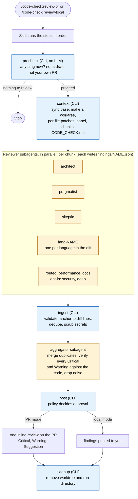

# Architecture and design

How code-check is built and why. For install and daily use see the [README](../README.md); for every setting see [CONFIGURATION.md](CONFIGURATION.md); for the maintainer tooling (shadow mode, golden cases, evals, hand-off rounds) see [MAINTAINING.md](MAINTAINING.md). Why each choice was made is recorded in [decisions/](decisions/README.md).

## Review flow

Findings are **Critical**, **Warning** or **Suggestion** and are posted inline on the changed lines. A panel of reviewers works on each change: up to 15 language experts (only for languages present in the diff), an architecture reviewer, a pragmatic reviewer and a skeptic, with an optional slot for a "deep" reviewer backed by your own knowledge sources, an opt-in security reviewer (see Security review below), a performance reviewer and a docs reviewer (see [Reviewer routing and full mode](#reviewer-routing-and-full-mode)). An Opus aggregator verifies every Critical and Warning against the code before anything is posted.

```
precheck (no LLM) → fetch latest base → context → reviewer panel (parallel) → ingest → aggregator → post (inline) → shadow record
```

If there is nothing to review, the run stops after `precheck` and spends zero tokens. A PR we already reviewed is skipped until a new commit lands. Replies on our threads are reported but never trigger a review unattended; an interactive `review-pr <PR>` shows them and offers a re-review. In PR mode `context` also writes `existing-comments.md` into the run directory: every inline review thread already on the PR (ours and humans', resolved and outdated included, bots excluded, unresolved first, scrubbed and capped), with replies since our last review tagged `[new]` and our own earlier comments tagged `[ours]` (they are not a maintainer's position). Threads with new replies sort first, so the caps never cut them. Reviewers and the aggregator read it as untrusted data so they do not repeat or contradict what maintainers already said; the aggregator records suggestion-level repeats as dropped with the reason `already-raised` (critical and warning findings are never dropped for it, so the approve policy still sees them), and style findings that cite no project precedent as `unsupported-style`. `context` lists the optional files present in the run directory (`CODE_CHECK.md`, `existing-comments.md`) as `run_files`, and reports the comments as `existing_comments` (`threads`, `comments`, `new_replies`); if the comments cannot be fetched the review still runs and `existing_comments_error` says why. `--with-replies` is accepted for compatibility and has no extra effect. GitHub (our latest submitted review on the PR) is the source of truth for "already reviewed"; the local state record is only a shortcut, so a fresh machine does not re-review.

**Review rounds.** In PR mode `context` counts our earlier reviews of the PR from the host (each carries the run marker) and, from the second review on, the lines added since our last one (`round` in `context.json`). From round `review.quiet_after_round` (default 3) `post` holds back Suggestions outside those lines and reports `held_back`; Critical and Warning findings are never held back, wherever they are. If the last reviewed commit is gone (a force-push) nothing is held back. Local mode has no rounds.

## Design: deterministic CLI, LLM judgment

The work is split on purpose. A deterministic CLI (`code-check`) does everything that must be exact: diff parsing, finding validation, deduplication, anchoring comments to lines, approval policy, state, and every `git` and `gh` call. Skills and subagents do only the LLM work: reviewing, aggregating and answering comments.



Orange boxes are LLM work and blue boxes are the deterministic CLI. A reviewer that fails or writes unusable output does not stop the review: `ingest` reports it as incomplete and the rest goes on. A reviewer that wrote no findings file at all (`missing`) is re-dispatched once by the review skills and `ingest` runs again; a second `ingest` keeps what the first found invalid, and a file that is still missing stays reported as incomplete. With several chunks only a reviewer that wrote no file in any chunk counts as `missing`. Every reviewer prompt names the reviewer's own `findings/<member>.json`; a `.json` file in `findings/` that belongs to no panel member is listed under `stray` in the `ingest` output.

`address-comments` and `babysit-pr` use the same CLI without the panel: `workspace` and `threads` collect the unresolved review threads, the skill checks each claim against the code and fixes what is valid, reviews those fixes once with the `review-local` flow in the worktree (its valid findings are fixed in the same push), then `commit`, `push` (behind the test gate), `reply` and `resolve` finish the job. Unattended runs (`loop`, `run-pr`) start one headless `claude -p` process per PR and run these same skills.

## Installer and unattended setup

### 2. Without going through Claude's marketplace UI (Node installer)

The package is **not published to npm yet**, and the npm name `code-check` has not been confirmed as ours, so do not run `npx code-check` until a release says it is published (an unrelated package could own that name). Today, run the installer from a clone or straight from GitHub:

```bash
node installer/cli.js install             # from a clone of this repository (needs only Node 20+)
npx github:subhiandrews/codecheck install             # straight from GitHub, no clone needed
```

Each takes the same subcommands:

```bash
node installer/cli.js install     # stage files, create the runtime, register the plugin with `claude plugin ...`
node installer/cli.js doctor      # check prerequisites at any time
node installer/cli.js uninstall   # add --purge-data to also delete shadow data and state
```

**GitHub, GitLab or both.** `install` and `doctor` take `--provider github|gitlab|both` (default `github`, so a plain `install` is unchanged). It only chooses which host CLI is a required prerequisite: `gh` for `github`, `glab` for `gitlab`, both for `both`. Which host a repository uses is decided per repository when you review it (see [GitLab](#gitlab-differences)), so one install serves GitHub and GitLab repositories alike; the installer receipt records the choice. The marketplace install above has no such step and needs only the CLI of the host you review on.

```bash
node installer/cli.js install --provider gitlab    # needs glab (glab auth login), not gh
node installer/cli.js doctor --provider both       # checks gh and glab
```

Once the package is published under a confirmed name, `npx code-check install` (and `doctor`, `uninstall`) will be the short form of the same commands.

If the `claude` command is not on the PATH, or its plugin commands fail, the installer falls back to **copy mode**: it copies the skills and agents into `~/.claude/skills` and `~/.claude/agents`. Copy mode never overwrites anything that already exists there. If a skill or agent of the same name is present it is left untouched, a warning is printed and that item is skipped. The installer writes a receipt (`receipt.json` in the data directory) listing exactly what it created; `uninstall` removes only what the receipt recorded, plus the staged plugin and the runtime it owns. Restart Claude Code afterwards.

Overrides: `CODE_CHECK_HOME` (data directory, default `~/.local/share/code-check`) and `CLAUDE_CONFIG_DIR` (default `~/.claude`).

### 3. Remote agents and CI

```bash
pip install git+https://github.com/subhiandrews/codecheck.git     # or a container image built from this repo
export GH_TOKEN=...            # GitHub: gh authentication, no interactive login
export GITLAB_TOKEN=...        # GitLab instead: glab authentication, no interactive login
export ANTHROPIC_API_KEY=...   # for the headless `claude -p` processes
code-check loop --mode review      # one iteration of the review loop
code-check loop --mode babysit     # one iteration of the babysit loop
code-check run-pr --mode review --pr OWNER/REPO#123            # GitHub
code-check run-pr --mode review --pr group/subgroup/project#7   # GitLab merge request
```

The `claude` binary must be installed and on the PATH (`run_pr.claude_bin`), and **the code-check plugin must be installed for that `claude`**: each headless process is only told to use the `code-check:review-pr` (or `code-check:babysit-pr`) skill, so without the plugin it has no skill, agents or `bin/code-check` to run. In the remote environment install it with `claude plugin marketplace add subhiandrews/codecheck` and `claude plugin install code-check@code-check`, or with `node installer/cli.js install` from a clone. `pip install` alone gives you the CLI, not the plugin.

Unattended runs have nobody to answer prompts, so they use `--permission-mode dontAsk --permission-prompts none` together with the per-mode allow-lists `run_pr.review_allowed_tools` and `run_pr.babysit_allowed_tools`, plus `--add-dir <state_dir>` (see "Prompt injection and unattended runs" below). There is no `--max-turns` limit; `run_pr.timeout_seconds` (default 1800) is the bound on a single run, and cloning a repository is bounded at 15 minutes.

Mount a volume at the data directory (`state_dir` and `shadow.store` in the config) so state and shadow data survive between runs. Nothing in the CLI prompts interactively.

### Codex

Use the Node installer with `--target codex` to install the interactive skills. See the [Codex installation guide](INSTALL-CODEX.md) for prerequisites, configuration, first run and measured sandbox limits.

## GitLab differences

The same four skills work on GitLab.com merge requests through the `glab` CLI. With the default `provider = "auto"`, a repository whose `remote` points at `gitlab.com` uses GitLab and any other remote uses GitHub. Set `provider = "github"` or `"gitlab"` to choose explicitly; an explicit choice is never overridden. Self-hosted GitLab is not detected and not tested: it would need `provider = "gitlab"` and `glab` pointed at that host. Pass a merge request as `group/subgroup/project#7` or its URL. Where GitLab differs from GitHub:

- **A review is a set of discussions plus one summary note.** There is no review object, so the summary note ends with a hidden marker holding the reviewed head SHA, which is how a later run knows that head was already reviewed. It is posted last, so a run that dies half-way is retried. When the host rejects an inline position, that finding is folded into the summary instead.
- **Approval** (`review.auto_approve`) approves the reviewed head only. If the host refuses it, the summary says so and the review is still recorded. GitLab does not say which commit an approval was for, so each approval is pinned to the head of the newest diff version that existed when it was given; an approval older than the latest push does not count for the new head.
- **Reactions** on review comments are not read, so shadow-mode outcome counts leave them out.
- **Checks** are the jobs of the merge request's latest pipeline; a failed job that is allowed to fail is reported as skipped.
- **Thread ids** look like `group/project:7:<discussion>`, because resolving a thread needs the project and merge request.

To test this on a real GitLab project, [gitlab-testing.md](gitlab-testing.md) has the test plan (three install cases, scenarios S1 to S6 and a list of what is still unverified), and `scripts/gitlab-sandbox/sandbox.sh` creates the public sandbox project it uses.

## Security review

The security reviewer is an optional panel member. It is one agent per chunk (not per language) and it owns every changed file. It looks for what deterministic scanners miss: committed secrets and credentials, including custom formats, personal data (PII) in code, logs and fixtures, injection, authentication and access-control mistakes, unsafe deserialization, SSRF and path traversal, weak cryptography, insecure defaults, secrets in CI and configuration files, and risky dependency additions. Findings use the category `security`: a committed secret or PII is Critical, a vulnerability is a Warning (Critical when it is exploitable as written).

It runs when asked or when routing finds a reason in the diff (see Reviewer routing and full mode):

- `/code-check:review-local security` and `/code-check:review-pr 123 security` (the `security` argument; with no PR, `review-pr` works the queue and configuration decides),
- `code-check context --security`, and `code-check run-pr --security` (review mode only),
- `review.security = true` in configuration, which also turns it on for `code-check loop --mode review`.

`address-comments` and `babysit-pr` never run it.

It uses `models.security`, default `"opus"`, because security recall matters more than token cost. Set `models.security = "sonnet"` to trade some recall for a lower cost. A repository's `.code-check.toml` may set `models.security` and `review.security`. Dispatch uses the model written into the generated agent files, so `models.security` only takes effect when `gen-agents` or the installer runs with that configuration (for a repository's file, run it inside that repository); re-run it after changing the model. Setting `review.security = true` in a repository makes every unattended review of that repository run one Opus agent per chunk.

It is guidance on top of your scanners, not a replacement for them. Warnings about vulnerable dependencies come from the model's own knowledge, with no network lookups, and are worded as something to verify. Review comments are public, so the agents are told never to print a secret or PII value; they name the file, line and kind of value only. As a backstop, the `message` of every finding, whatever its category, is scrubbed of secret-looking values when findings are ingested. A `suggestion` that the scrub would change is withheld entirely (and the message says so) rather than posted with its code rewritten.

## Performance review

The performance reviewer is an optional panel member. It is one agent per chunk and owns every changed file. It looks for code that is correct but wasteful, and for code that can exhaust memory or hang: membership tests and nested loops over the same collection, work that could be hoisted out of a loop, queries or calls made once per item (N+1) and joins done in application code, expensive conditions checked before cheap ones, the wrong data structure (a list where a set or dict fits), unbounded loads, collections and caches that only grow, handles opened in a loop and never closed, and blocking calls in async code. Findings use the category `performance`.

Severity follows the failure, not the pattern. Critical means the code can crash, exhaust memory or hang on realistic input, and the finding must say what grows or blocks and what input triggers it. Warning means correct but wasteful in a way that will matter as data grows. Suggestion means a small gain or one off any hot path. The same quadratic loop is a suggestion over a fixed handful of items and can be Critical over request-supplied data; when the reviewer cannot tell how large the input is it caps the finding at Suggestion. Each finding states the complexity before and after.

It runs when asked or when routing finds a reason in the diff (see Reviewer routing and full mode):

- `/code-check:review-local performance` and `/code-check:review-pr 123 performance` (the `performance` argument; with no PR, `review-pr` works the queue and configuration decides),
- `code-check context --performance`, and `code-check run-pr --performance` (review mode only),
- `review.performance = true` in configuration, which also turns it on for `code-check loop --mode review`.
- the diff scores at least `review.routing.performance_min_score` (default 3), for example a nested loop or a query inside a loop; `review.routing.mode = "off"` turns this off.

`address-comments` and `babysit-pr` never run it. It uses `models.performance`, default `"sonnet"`; a repository's `.code-check.toml` may set `models.performance` and `review.performance`, and `models.performance` only takes effect after `gen-agents` or the installer re-runs. Setting `review.performance = true` in a repository adds one agent per chunk to every unattended review of it. It is guidance on top of profilers and benchmarks, not a replacement: it reads code and does not measure it.

## Reviewer routing and full mode

`code-check context` decides which optional reviewers a change earns, in code (`core/routing.py`), never in a prompt. Each decision and its reason is written to `panel.routing` in the `context` output and `context.json`.

- **Architect:** dropped for a clearly small change: at most `review.routing.small_max_lines` changed lines (default 40) in at most `small_max_files` files (3), with no added, deleted or renamed file and no manifest, pipeline, migration or interface file (`pyproject.toml`, `package.json`, `.proto`, `.github/workflows/`, `__init__.py` and similar). The pragmatist and skeptic always run.
- **Performance:** added when the added lines score at least `performance_min_score` (3). A nested loop scores 3, a query or other I/O inside a loop 3, a blocking call inside async code 3, a sort, linear search, string build, regex compile or copy inside a loop 2, a list membership test or an `await` inside a loop 2, an unbounded read (counted once) or cache 2, a SQL file 2, a lone loop 1 (at most 2 in all), a heavy collection type 1 (at most 2). Test files and comments never score. It is a regex-level guess about what deserves the reviewer's time, not a finding.
- **Docs:** added when a documentation file changed (agent and skill prompts, `SKILL.md` and files under `agents/` or `.claude/`, are not documentation). The number of added comments never routes it.

Flags and configuration always win: `--security`, `--performance`, `review.security` and `review.performance` force a reviewer on, and routing never removes one. `review.routing.mode = "off"` restores the fixed panel (architect, pragmatist, skeptic).

**Full mode** puts every reviewer on the panel (architect, pragmatist, skeptic, security, performance, docs, every language expert, and the deep reviewer when available) and skips routing entirely. Ask for it with `/code-check:review-local full` or `/code-check:review-pr 123 full`, `code-check context --full`, `code-check run-pr --full`, or `review.full = true`, which also applies to `code-check loop --mode review`. `models.performance` and `models.security` still choose their models.

## Docs review

The docs reviewer is a skeptic about documentation. Its default stance is that documentation must be limited, precise and current. Before it runs, code (`core/doccheck.py`) measures the change and writes `docs-metrics.json` into the run directory: the added comment and docstring lines against the added code lines, and the documentation files that changed. There is no limit on how many comments a change may add; the reviewer judges each comment on its own merit. The scan is a line scanner, not a parser, so treat the counts as an estimate.

It flags comments that restate the code or narrate the change, new documentation files that duplicate existing ones or will not survive the next code change, verbose additions to existing documentation, and documentation the change makes wrong. Findings use the category `docs`: an incorrect document or comment is a Warning, verbosity or a needless file a Suggestion. It never asks for more documentation. The only exception is an explicit rule about documentation or comments in the project's `CODE_CHECK.md`, which is read from the base branch so a PR cannot grant itself one. It uses `models.docs`, default `"sonnet"`.

## CODE_CHECK.md

Put a `CODE_CHECK.md` at the root of a repository to tell the reviewers what to look at and what to ignore, in plain prose. Every reviewer and the aggregator read `context.json` first and then each file listed in its `run_files` (`context` copies `CODE_CHECK.md` into the run directory when it exists), and `address-comments` and `babysit-pr` receive it as `guidance` from `code-check workspace`.

- **Where it is read from.** PR runs read it from the **base branch**, never the PR head, so a PR cannot rewrite the rules it is judged by. Local runs read the file in your working tree.
- **Nested files.** In a monorepo, a `CODE_CHECK.md` in any directory above a changed file is read as well and applies only to files under that directory. Which files are read follows from the changed paths alone, never from the directory the tool was started in, so PR, local and unattended runs agree. They are joined into the one run file, root first and then shallowest first, and each nested part starts with a line that names its directory and says that, for files under it, its rules win over any less specific rule they conflict with. `address-comments` and `babysit-pr` get the nested files above the paths the PR changes, after the same `review.ignore` filter.
- **Size.** At most 16,000 characters for all files together; room is kept for nested files, so a large root file is cut first. Longer text ends with a visible truncation marker; a nested file that does not fit is left out and named in `skipped`. A cap on the directories checked, or a failed lookup, is also noted in the text and sets `truncated`. `context` reports `guidance` as `{source, truncated, files, skipped}`; `workspace` includes the text as well.
- **Missing is fine.** A missing, unreadable, non-UTF-8, whitespace-only or symlinked file is ignored, with no error and no warning. So is a nested file reached through a symlinked directory.
- **Learning (opt-in).** With `review.learn_guidance = true` (user config only, off by default), `review-local` ends by running `code-check guidance evidence`. It reads the local shadow store for the directory the command runs in: finding categories the author's own verdicts called incorrect in at least two PRs and more often than confirmed, and human review comments no finding matched, from at least two PRs. When there is such evidence that was not proposed on before, the model writes the whole new file and `code-check guidance apply` checks it (at most 8,000 characters and 40 changed lines, no secrets, evidence unchanged since it was read) and writes it to the working tree, never through a symlink. It never stages or commits, so nothing reaches the base branch, and therefore any PR review, until you commit and merge it. `review-pr` can do the same for a PR you review, but never writes a working tree: it runs `guidance evidence --base <base_ref>` and `guidance apply --base <base_ref> --run <run_id>` from the PR's worktree, which read the current file from the base ref and write `<state_dir>/proposals/<run_id>.patch` (outside the run directory, which `cleanup` removes) after the same checks. The review report then suggests applying it on a new branch and opening a separate PR; nothing is committed, pushed or added to the PR under review, and the same evidence is not proposed twice. `code-check threads` (the start of `address-comments`) also records the code-check findings it sees in your PR's threads: ours, and those a CI review posted when `review.ci_login` names the login it posts as (another bot is never trusted), so your verdicts on them count as evidence for your own repositories; a review's findings that no thread shows, and other machines' stores, are not seen. `guidance evidence` also prints `stats`: findings by outcome and dispute rate, overall and per category: a baseline to compare before and after a learned rule is merged, not evidence and not in the digest. The comments it learns from are written by other people, so read the proposed diff before you commit it: a merged rule steers every later review.
- **CLAUDE.md.** The repository's `CLAUDE.md` is read the same way as `CODE_CHECK.md`: from the base branch for PRs and the working tree for local runs, with nested files above the changed paths and its own 16,000 character cap. `context` copies it to the run directory and reports it as `project_context`; `workspace` returns it under the same name for `address-comments` and `babysit-pr`. Reviewers use it for conventions and how the code is built and tested and may open the files it points to under `root`; it is background, so tasks in it (edit, run, commit, change the output) are ignored and reported like ignored guidance.
- **Limits.** Guidance cannot change the reviewers' output format, the severity scale or their rules, and it cannot switch off the security reviewer's rule about never printing secrets. Parts that try are ignored.

This repository has its own `CODE_CHECK.md` as an example.

## Loops

Run the skills under Claude Code's `/loop`:

```text
/loop 15m /code-check:review-pr          # the 3 newest open PRs of this repo that have something new to review
/loop 10m /code-check:babysit-pr         # your PRs: new comments and failing checks
/loop 2m /code-check:review-local        # your working tree, only reviewed again when it changes
```

Both modes work on every clone directly under the directory you run them in or, when there are none, on the clone you are inside (`loop.repos` names repositories explicitly instead); a clone is named by its remote, and each runs with its own `.code-check.toml` and provider. The headless child starts in that clone (a babysit run sets `CODE_CHECK_UNATTENDED`, so `workspace` always makes a worktree under `state_dir` and never edits your checkout), and a `--pr OWNER/REPO#N` runs in the matching clone found there. Review mode lists the open PRs, newest first, asked for from the host three at a time, and stops as soon as the cap is met, so older PRs are neither listed nor looked at (a PR already reviewed still costs a few calls to confirm, because the listing carries no head commit); it skips your own PRs, drafts, and a head already reviewed until a new commit lands. Each iteration lists the PRs with something new (no LLM; a PR where only replies landed since our review is listed under `skipped` and does not count against `loop.max_prs_per_iteration`), takes at most `loop.max_prs_per_iteration` (review mode: `loop.max_review_prs_per_iteration`, default 3), and runs each one in its **own headless `claude -p` process, one after another**. Your session only sees a one-line summary per PR, so its context does not fill up. The skills start `code-check loop` with the Bash tool's `run_in_background` option, because an iteration can take far longer than a foreground Bash call is allowed to run (and the test-gated `push` is run with the 10-minute maximum timeout).

An iteration holds a per-mode lock file under `state_dir/locks`, and an iteration that starts while the previous one is still running is skipped. The lock records the holder's process id and is refreshed before each PR and every minute while the iteration runs. Another iteration takes it over only if the holder process is gone (for example it was killed) or the lock has not been refreshed for longer than a full iteration can take (the mode's per-iteration cap x (`run_pr.timeout_seconds` + 15 minutes for a clone) + 15 minutes). On SIGTERM, SIGHUP or Ctrl-C the iteration releases its lock before exiting. If the loop process is killed with SIGKILL while a headless `claude` child is running, that child is not stopped and can overlap with the next iteration's run.

Loop bookkeeping is kept separately from review results. A PR whose headless run succeeded is recorded as done for its current fingerprint (head commit plus new threads and check states) and is looked at again only after something changes on it. A run that failed (a failed clone, a missing `claude` binary, a usage limit, a timeout, an error result) is **retried on the next iterations, up to 3 attempts per fingerprint**; after the third failure the PR is set aside until something changes on it, so a PR that always fails cannot starve the queue. A failed run never counts as "already reviewed": only a successfully posted, complete review marks a head as reviewed, so `code-check run-pr --mode review --pr OWNER/REPO#123` retries a failed review at any time. The review loop also skips a head that you already reviewed by hand. A review that posted but was incomplete (a reviewer failed) is marked `review-incomplete` for that head, so interactive `review-pr` and `run-pr` retry it; the loop's own bookkeeping treats an ok headless run as done until the PR gets a new commit. `precheck --force` skips the GitHub activity fetch, so its `replies` list is `[]` then.

State lives in `state_dir/state.json` (the directory is created readable only by you). Every change to it is a read-modify-write under a short lock (`state.json.lock`), so concurrent processes do not lose each other's updates. A corrupt state file is moved aside to `state.corrupt` and treated as empty rather than crashing the loop. If listing one PR fails (for example a GitHub error), that PR is reported under `skipped` with the reason and the rest of the iteration goes ahead.

## Safety model

- Never force-pushes: the git layer has no force option. Pushes happen only after the configured `address.test_command` passes (when set) and only when the remote branch has no commits you lack.
- Draft PRs are never posted to and never approved. A PR whose head moved while the review ran is not posted either; re-run the review.
- The loop never handles more than `loop.max_prs_per_iteration` (review mode: `loop.max_review_prs_per_iteration`) PRs per iteration, one at a time.
- Unattended runs can use only the tools in `run_pr.review_allowed_tools` / `run_pr.babysit_allowed_tools`, which include plain `Bash` and unscoped `Write` by default. See "Prompt injection and unattended runs" below.
- Refuses to run `address-comments` on a working tree with uncommitted changes, and works in an isolated worktree when you are not on the PR branch.
- Fork-based PRs can be reviewed with `/code-check:review-pr <PR>` but cannot be pushed to in Phase 1. The unattended review loop skips them unless `loop.review_forks = true`.
- An unattended babysit run always works in a clone the tool manages under `state_dir/repos` and a worktree under `state_dir/worktrees`, never in your own checkout.
- If the same finding was already posted inline by you on the PR (found by its hidden marker), a later review does not post it again.
- A thread you pushed back on is never resolved by the tool; the reviewer resolves it.
- A review is never approved if the PR is a draft, if any reviewer failed or returned invalid output, or if the PR head moved while the review ran. If GitHub rejects an inline anchor, the findings are posted in the review body instead of being lost.
- Every run first fetches the latest remote base and compares against `<remote>/<base>`, not your local base branch. If the fetch fails the output says "base may be stale".

### Prompt injection and unattended runs

Everything in a PR (code, comments, commit messages, the description) is untrusted text that ends up in the context of a headless `claude -p` process nobody is watching. A PR can contain instructions aimed at the model. Keep that in mind when you choose what those processes may do:

- **Fork PRs.** Anyone can open one. The unattended review loop skips them by default (`loop.review_forks = false`); turn that on only if you accept that strangers' text reaches an unattended session. Babysit never handles forks.
- **Bash.** The default allow-lists contain plain `Bash`, because the skills run `"${CLAUDE_PLUGIN_ROOT}/bin/code-check"` by absolute path and an allow rule for an absolute command path (`Bash(/path/to/bin/code-check:*)`) has not been verified to work. Plain `Bash` lets a manipulated session run any command as you, with your `gh` and git credentials. To narrow it, replace `"Bash"` with prefix rules such as `"Bash(git:*)"`, `"Bash(gh:*)"` and a rule for the `bin/code-check` wrapper, and check with one supervised `code-check run-pr` that the run still works (denials show up in the run's output).
- **Write and Edit.** Reviews get `Write` (reviewers write their findings files) but no `Edit`; babysit runs get both, since they fix code. `Write` is not scoped to a directory by default: a path-scoped rule such as `Write(<state_dir>/runs/**)` has not been verified, so it is left to you to try.
- **`--add-dir`.** Runs are given `--add-dir <state_dir>` so they can reach the worktrees and run directories there. This flag is not covered by the CLI spike this project was built against; if your `claude` rejects it, set `run_pr.add_state_dir = false`.
- **Auto-approve.** With `review.auto_approve = true`, an unattended review that a PR talked into reporting nothing would approve it. The approval decision is made in code from the findings, but the findings come from the model. Keep auto-approve off for repositories that accept outside contributions.
- **CODE_CHECK.md.** Its text is read from the base branch, which anyone with push access to it can write, and it reaches unattended babysit runs, which have `Edit` and `Bash`. Treat it as trusted configuration and restrict who can change it.
- **Security reviewer cost.** `review.security = true` in a repository's `.code-check.toml` makes every unattended review of that repository pay for an Opus agent per chunk.
- **Repository config.** A repository's `.code-check.toml` cannot change any of the above (see [CONFIGURATION.md](CONFIGURATION.md)).

