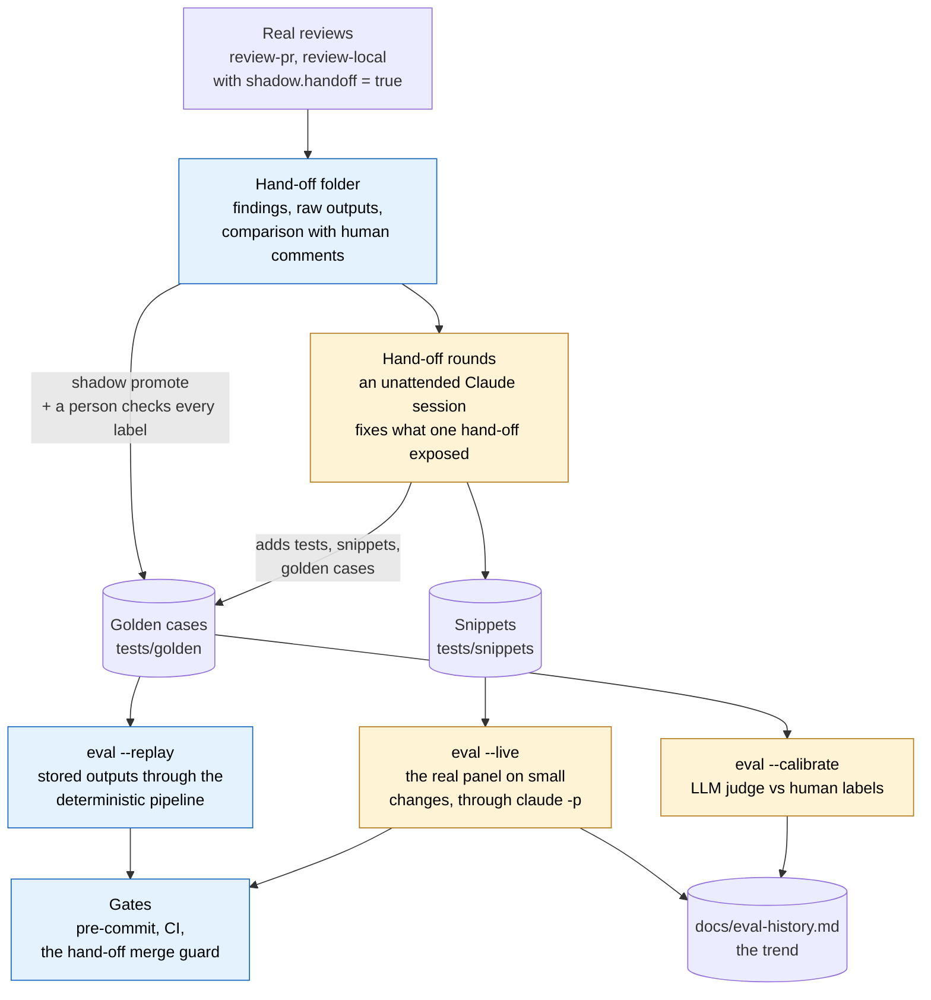

# Evals

code-check reviews pull requests with a panel of LLM reviewers, and a model's output changes from run to run. The evals exist to answer one question: **did a change make the reviews better or worse?** There are four of them. Each answers a different part of that question, and none of them answers all of it, so this page explains what each one measures, how they connect, and how far to trust each number.

The README is the reference for flags and output shapes. The records in `docs/decisions/` say why each piece was built. This page is the map between them.

## The picture

Orange steps call a model and cost tokens. Blue steps are deterministic and free.

## The four evals

| | `eval --replay` | `eval --live` | `eval --calibrate` | `eval --history` |
|---|---|---|---|---|
| Question | Does the pipeline still turn the same reviewer output into the same posted review? | Does the real panel still find the bugs it should, and stay quiet when it should? | Does the judge model agree with the humans who reviewed real findings? | How are the scores trending? |
| Uses a model | No | Yes | Yes | No |
| Input | `tests/golden` | `tests/snippets` | `tests/golden` labels | `docs/eval-history.jsonl` |
| Cost | Free, seconds | Real tokens, minutes | Real tokens | Free |
| Runs | Every commit, CI, merge guard | New-branch push when review behaviour changed; by hand | By hand | By hand |
| Blocks anything | Yes | Yes, when a model is reachable | Never | Never |
| Follows | The CLI code | The skills and agents | The judge | n/a |

The last row is the one to remember. Only the live eval moves when a reviewer prompt gets better or worse. Replay never calls a model, and calibration measures the judge, not the reviewers.

### Replay: the deterministic half

A golden case freezes one review run: the diff, each reviewer's stored findings, the aggregator's raw output, and what the pipeline posted for it once a person confirmed it. Replay feeds the stored outputs through the same steps as `ingest` and `post`: validation, duplicate merging, anchoring to the diff, the inline cap, the approval policy and rendering. It then compares file, line, category, severity, inline or summary, and the decision, in order.

Because no reviewer runs, replay is exact. It catches a change to the CLI that alters what gets posted. It cannot tell you whether a reviewer prompt is any good. That is why it can run on every commit and in CI without secrets or network.

The repository ships **7 golden cases**. Six come from real pull requests (Guava and Tokio) and one, `seed-pipeline`, is hand-built.

### Live: the part that follows the prompts

A snippet is a folder with a `base` and a `change` and a list of the findings a review should produce (`expected`) and should not produce (`must_not_report`). `eval --live` builds a throwaway git repository for each one, runs the real `review-local` flow through `claude -p`, and reads the aggregator's output back.

Reviews vary from run to run, so the matching is tolerant on purpose. A reported finding matches an expected one when the file is equal, the category is one of the accepted names, and the line is within 2 (`TOLERANCE` in `src/codecheck/evals/match.py`). The severity must then be equal. A snippet passes when at least 80% of its expected findings match (`RECALL_BAR`), nothing forbidden is reported, and no Critical appears that matches nothing expected. A run that fails to produce output fails its snippet, so a broken run is never read as a clean review.

Each run is isolated. State, the shadow store and review bookkeeping point into a temporary directory through `CODE_CHECK_` variables, and git's repository-selecting variables are unset, so an eval started from a git hook cannot touch your own repository.

The repository ships **8 snippets**: `clean-code` (which should produce nothing), `docs-only-api`, `off-by-one`, `weaker-access-override`, `rust-shutdown-race` and `poisoned-memory-lesson` (a poisoned memory lesson must not hide a real SQL injection), `memory-dispute-lesson-downgrades-false-positive` and `memory-miss-lesson-surfaces-issue`. The last three are the snippets that read memory, from lessons seeded into a store in their own work directory (see [Memory evals](#memory-evals)). Four are marked `"calibrated": true`, meaning they were run by hand against a real model and passed every time. The race and the three memory snippets are not calibrated yet. Each snippet is worth an eighth of the score, so one flaky run moves the headline by about 13 points.

### Calibrate: measuring the measuring stick

Matching findings by file, category and line is deterministic but blunt. It misses the right problem reported under another category, and it cannot express a concern about a pattern. A judge model could answer "is this the same issue?" in plain language. A judge is also a model, so it has to be measured before anything relies on it.

`eval --calibrate` asks the judge (`models.judge`, default `opus`) whether each human-labelled finding in the golden set is worth raising for its diff, then compares the answer with what the humans did. `expected` means a person resolved or agreed with it, and `not_expected` means a person disputed it. It reports agreement and Cohen's kappa, and it passes at 80% agreement (`AGREEMENT_BAR` in `src/codecheck/evals/judge.py`) with no unusable answer.

The first real run, on 2026-11-15, **failed**: 14 findings judged, 7 agreed, kappa -0.32. The judge sees only the diff, so it under-credits findings that depend on surrounding code, and it is stricter than the humans in some places and more lenient in others. A human label also reflects what a maintainer chose to do, which is not always the same as whether the finding was right. The conclusion in the design record is that nothing should depend on the judge yet. This is why it is advisory: it never runs in CI, in the gates or in the merge guard.

### History: the trend

Every full `eval --live` or `eval --calibrate` run appends one line to `docs/eval-history.jsonl` (time, commit, branch, models, score, cost) and regenerates `docs/eval-history.md`, which charts each mode with a rolling average. The record is append-only and merges by union, so two branches that each ran an eval keep both lines. Nothing is committed for you: the developer commits both files with their change.

Gates and hand-off rounds pass `--no-record`, because a gate runs after the commit and recording it would only leave the tree dirty. So the chart moves only when someone chooses to measure and commit.

## Memory evals

Review memory (`memory.read`) has its own advisory measurements, kept apart from the four above because each answers a different question and none of them gates anything (`docs/decisions/0042-memory-evals-are-advisory-and-report-retrieval-and-effect-separately.md`, and `docs/decisions/0023-the-llm-judge-is-advisory-only.md` for why). They are never written to `docs/eval-history.jsonl`.

| | `eval --memory-retrieval` | `eval --memory-effect` | `memory report` |
|---|---|---|---|
| Question | Does retrieval return the right lessons, and only those? | Does a lesson change a review the way it should? | In real use, did findings fare differently when lessons were shown? |
| Uses a model | No | Yes (two reviews per snippet) | No |
| Input | the JSON files in `tests/memory/retrieval` | the snippets in `tests/snippets` that carry `memory` | the shadow store |
| Output | recall@5 and MRR per retriever, per case and overall | per pair: what memory suppressed, surfaced or lost | dispute and confirm rates per repository and arm, with sample sizes |

### Retrieval

A case seeds a few synthetic lessons (no real repository content), asks queries (the paths of a diff, or candidate findings) and names the lessons that should come back (`expect`) and must not (`expect_absent`: expired, candidate, another language, a path that no longer exists, another repository). It also checks the rendered `memory.md`: a poisoned, instruction-like statement must be retrieved and shown only on its framed statement line, and a contested lesson must show both counts. recall@5 is the share of expected lessons in the top five, and MRR is the mean of 1 over the rank of the first expected lesson. A query marked `"tier": "semantic"` is one the exact-key baseline is not expected to answer; it counts in the totals and is also reported under `by_tier`, so the gap a semantic retriever should close is visible.

A retriever is a function from a query to lesson ids, best first. `exact` calls the real `memory/retrieve.py`. Another one is added with one line, `register_retriever("name", fn, available=reason_or_none)` in `src/codecheck/evals/memory_retrieval.py`, and then scored next to it (`--retriever NAME` scores one). When `available()` gives a reason (for example Ollama is not running), `--if-reachable` reports `skipped` for that retriever instead of failing.

### Effect

For each snippet with `memory` lessons, `eval --memory-effect` reviews it with memory off and again with the lessons on, and reports `suppressed` (a forbidden finding the off arm reported and the on arm did not), `surfaced` (an expected finding only the on arm found) and `lost` (an expected finding only the off arm found, the harm a poisoned lesson could do). `as_expected` means the on arm met the snippet's expectations and lost nothing. The snippet's own `expected` and `must_not_report` are the memory-on expectations; `memory_effect.off` can override either list for the off arm. `poisoned-memory-lesson` is the harm check (a true critical must survive a lesson that says to drop it), `memory-dispute-lesson-downgrades-false-positive` the help check for the aggregator and `memory-miss-lesson-surfaces-issue` the help check for the reviewers. Run it by hand, each review is real tokens, and read it over several runs: one pair is one sample.

### Online

`memory report` splits the findings of non-blind runs by whether memory was read (a `memory` record or `memory.read` in the run record) and joins them with the outcomes collected later. It is observational (runs are not assigned to an arm at random), per repository, and flags `underpowered` below 30 findings per arm (`--min-findings`).

## Where the data comes from

The golden cases are not written by hand. They come from real reviews:

1. With `shadow.handoff = true`, a review writes a hand-off folder after it posts: the run, every reviewer's findings, what the aggregator dropped, deterministic signals from the session transcript, and the raw outputs needed to replay it.
2. In PR mode the run is blind. The reviewers never see the PR's existing comments, so their findings can be compared with what humans said independently. That comparison produces matched findings, findings no human raised, and human comments the review missed.
3. `shadow promote` turns a hand-off into a draft case with automatic labels. A person checks every label and marks the case confirmed, and only then does `--finalize` write it into `tests/golden`. Cases from private or unknown-visibility repositories are refused unless you opt in, because golden cases are committed.

All of it is local and scrubbed of secrets before it is written. The scrub is pattern matching and best effort, so the shadow directory is treated as sensitive.

## How they fit into the workflow

- **On every commit**, `scripts/gates.sh` runs replay. CI runs it too, and so does `handoff-queue check`, the merge guard for unattended rounds, which refuses to pass when replay fails.
- **On the push that creates a new remote branch**, the gate runs replay again and then the live eval, but only when the branch changed a path listed in `scripts/gate-paths.txt` (the agent prompts, the skills, default models and the review pipeline). It skips and never blocks when no model is reachable.
- **In a hand-off round**, an unattended session picks one pending hand-off, writes failing tests first, fixes the cause, may add a snippet and a golden case (labelled `labelled_by: "handoff-round"`), runs replay and the live eval, opens a PR, and merges it when CI is green and the guard says `ok`. The guard runs from the installed plugin, not from the branch under test, so a round cannot change the code that judges it, and it blocks edits to existing golden cases and deleted tests or snippets.

| If you changed | Run |
|---|---|
| `ingest`, `post`, diff anchoring, severity policy, rendering | `eval --replay` (the commit gate does it) |
| Reviewer or aggregator prompts, skills, default models | `eval --live`, then commit the history |
| The judge prompts or the judge model | `eval --calibrate`, then commit the history |
| A golden case | `eval --replay`; `eval --calibrate` if you changed labels |

## Design decisions

- **A deterministic CLI and a thin LLM layer.** Anything that must be exact (parsing, anchoring, dedupe, policy) is Python, and only reviewing is LLM work. That split is what makes replay possible: the exact half can be tested exactly.
- **No live eval in CI.** Runners may have no model access, fork PRs have no secrets, and a flaky required check trains people to bypass checks. The live eval is gated locally on the paths that can change review behaviour, and CI keeps the deterministic backstop.
- **Tolerant matching and a recall bar.** A model that is right 4 times out of 5 is not broken, and an exact-match bar would make the gate noisy enough to be ignored.
- **A judge must be measured first.** The calibration eval was built before anything depended on a judge, and its failing result is why nothing does.
- **Humans label, never the tool.** Automatic labels are drafts, and a golden case needs a person to confirm each one.
- **Isolation by environment.** Evals never touch your own state, shadow store or repository.

## Reading the numbers

- A single live score is noisy. Read the rolling line in `docs/eval-history.md`, and check the models column before crediting a prompt change, since a model swap moves the score too.
- Rerun a failing snippet once before changing it. The README says the same.
- Replay passing says nothing about review quality. It says the pipeline still behaves as it did.
- The calibration score does not follow the reviewers. A flat line there is expected.

## Known limits

- The sets are small: 7 golden cases and 8 snippets. The live score is coarse and the calibration estimate is weak.
- The evals cover the review panel. The `address-comments` flow records its verdicts in shadow mode, but nothing evaluates them.
- No eval scores the reviewers with a judge yet. The pair question ("is this the same issue as that concern?") is the better basis for one, and it needs snippets that carry explicit concerns. See `docs/decisions/0023-the-llm-judge-is-advisory-only.md`.
- The live eval is local, so a contributor who never installs the git hooks never runs it. CI does not backstop that.

## Where to read more

- `README.md`: the "Shadow mode", "Golden cases and replay", "Live snippet eval", "Judge calibration" and "Eval score history" sections, for flags and output.
- `docs/decisions/0007-hand-offs-are-read-from-the-session-transcript.md`, `0009-golden-cases-need-human-confirmed-labels.md` and `0010-replay-gates-every-commit-live-eval-is-manual.md`: hand-off data, the golden set, replay, the live eval and the gates.
- `docs/decisions/0023-the-llm-judge-is-advisory-only.md`: the judge and its first calibration.
- `docs/eval-history.md`: the scores over time.
