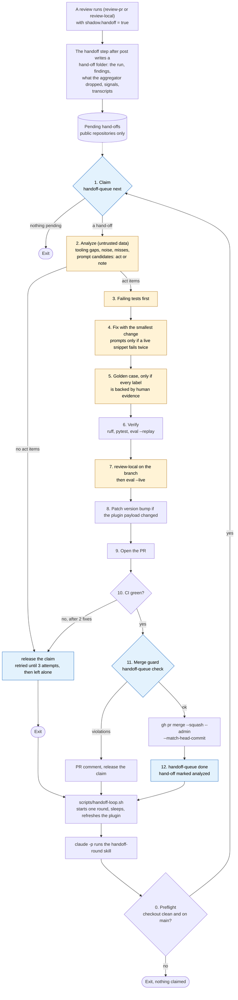

# Maintaining code-check

Developer and maintainer tooling: shadow mode, hand-off data, golden cases, evals, hand-off rounds and the commit gates. None of this is needed to use the skills. Settings for these features are in [CONFIGURATION.md](CONFIGURATION.md); the design is in [ARCHITECTURE.md](ARCHITECTURE.md).

## Shadow mode

Use it first alongside human reviewers. It does not change behavior; it records what the tool did so human feedback can improve the skills and become a golden evaluation set.

Everything is local: nothing leaves your machine unless you set `memory.url` and list repositories in `memory.share_repos` (see [Hosting the memory server](#hosting-the-memory-server)); with either empty, nothing is pushed (with `memory.url` set, a review still reads the repository it reviews, which sends the server that repository name). It is written as JSONL under `shadow.store`: the run, every reviewer finding, which ones the aggregator kept, what was posted, the decision, and the verdict for every comment `address-comments` evaluated.

`shadow.handoff` (default `false`) turns on the hand-off data recording and makes the shadow store available even when `shadow.enabled = false`. Like the rest of `[shadow]` it can only be set in your user config or with `CODE_CHECK_SHADOW__HANDOFF=1`, never in a repository's `.code-check.toml`.

### Hand-off data

With `shadow.handoff = true`, `context` reports `handoff: true` and the `review-local` and `review-pr` skills run one extra step after `post` and before `cleanup`: `code-check handoff --run <run_id>`. With the flag off the skills skip that step, so nothing about a run changes; called directly, the command prints `{"handoff": false}` and writes nothing. It is an internal step and is not listed in `code-check --help`. It never fails a review: any error comes back as `{"handoff": false, "error": ...}`.

It writes to `<shadow.store>/<run_id>.handoff/`:

- `handoff.json`: the run (skill, mode, repo, PR and its URL, head SHA, a `config_hash` of the effective configuration, models, panel, and the plugin build: `plugin_root`, a 12-character `prompts_hash` over the agent and skill prompts, and `build_reason` saying why those two are null; the root is `CODE_CHECK_PLUGIN_ROOT`, which `bin/code-check` exports, else `CLAUDE_PLUGIN_ROOT`, else the checkout), each reviewer's status from `ingest`, the aggregated findings in the order `post` uses, the aggregator's `dropped` list, the decision, `ignored_guidance` (up to 20 transcript lines, from agents' replies and tool results, that report `ignored guidance:`), deterministic `signals` from the session transcript (failed tool calls, retries, permission denials, turns and output tokens per agent), and for a posted PR review a `comparison` of human comments with our findings: which ones matched (same file, line within 3), the severity a human gave when the comment starts with Critical, Warning or Suggestion (otherwise null), findings no human raised, and human comments we missed (every comparison entry carries the comment's scrubbed `body`). It fetches the PR's threads and writes the same `human_comment` records as `shadow collect`. A PR review that was not posted (stale head, dry run) is still compared, against the threads as they are now, and is marked `comparison_mode: "unposted"` with `head_moved` (whether the PR head differs from the reviewed one; null when the run recorded no head) and `pr_state` (open, closed or merged). `general_comments_reason` says why the PR's general comments are missing when fetching them failed (null otherwise). A draft PR or a local review gets no comparison and says why.
- `handoff.md`: the same run as a short narrative for a person or a later session.
- `transcript/`: copies of the Claude Code session transcript that mentions the run id (under `$CLAUDE_CONFIG_DIR/projects`, else `~/.claude/projects`, newest first, last 24 hours) and its subagent transcripts. When none is found, `handoff.json` says so with `transcript: false` and a reason.

Two things the design lists are deliberately not in `handoff.json`: tokens and duration per reviewer (subagent transcripts are named by file, not by panel member, so they cannot be attributed reliably; `signals` gives turns and output tokens per transcript file instead) and stale-PR retries (a stale review restarts the skill with a new run id). The docstring of `src/codecheck/shadow/handoff.py` lists the fields.

It also saves the raw reviewer and aggregator outputs with the panel and chunk metadata as `<run_id>.raw.json`, so the run can be replayed later.

**Blind mode.** In PR mode a hand-off run is blind: `context` does not give the reviewers the PR's existing comments or replies (no `existing-comments.md`) and reports `blind: true`, so their findings can be compared with what humans said independently. Blind reviews can repeat a point a human already made; turn `shadow.handoff` off for reviews you want to post as final.

**Privacy.** Transcripts hold everything the session saw: code, PR text, command output. They are copied with the same pattern scrub as the rest of the shadow data, which is best-effort and can also garble an occasional line, so the copies are for reading, not parsing. Treat the shadow directory, and the hand-off folders in particular, as sensitive.

Secrets are scrubbed before anything is written (private keys, GitHub, Anthropic, AWS, Slack, Stripe and Google tokens, bearer and authorization headers, JWTs, and `password=`/`token=`-style assignments). The scrub is pattern matching and therefore **best-effort**: it cannot guarantee that every secret is removed, so treat the shadow directory as sensitive.

```bash
code-check shadow collect --all                       # later: record what humans did with each comment
code-check shadow export-golden --out golden.jsonl    # auto-labelled examples (confirmed, disputed, replied, misses)
```

`collect` records resolved or outdated threads, human replies and reactions, and human comments the tool never raised. Findings nobody reacted to are false-positive candidates; human comments with no matching finding are misses. Labels are marked `auto` for a human to review.

### Automatic collection (`memory.collect`)

With `memory.collect = true` (user config only), `cleanup`, which ends every review skill, collects outcomes for reviewed PRs that are due and then consolidates the shadow store into `memory.store`. A PR is due 1, 3, 7 and 14 days after its review was posted (the `decision` record's time, else the `run` record's); a newer review restarts the schedule. The host does not say when a PR closed, so the first collection that sees it closed is taken as its closing time, and collection stops 7 days later. Each call handles at most 3 PRs (newest review first) and stops starting new ones after 10 seconds. Bookkeeping lives in `state.json` under `memory:collect:<ref>` (`posted`, `done` milestone index, `closed_at`). A PR that fails (host error) is not marked and is retried on the next call. Collection reuses `shadow collect`'s function, never changes `cleanup`'s output, and also runs in blind hand-off runs because it gathers evidence and reads no memory.

```bash
code-check memory collect --dry-run   # list what is due
code-check memory collect             # collect and consolidate now (works with memory.collect = false)
code-check memory collect --all       # ignore the schedule
```

Verdict evidence takes its role at extraction time from the thread's `outcome` replies: the role that counts most against a finding (maintainer, then contributor, self, unknown, author), or `self` when the thread has no replies. Older records without roles load as `unknown`.

### Golden cases and replay

A golden case is one JSON file in `tests/golden/` holding a review run frozen in time: the diff, each reviewer's stored findings, the aggregator's raw output, and what the pipeline posted for it as a human confirmed it (`expected_posted`: file, line, category, severity and whether it went inline or only into the summary; and `expected_decision`, the decision the approval policy would reach with `auto_approve` on, so `APPROVE` exactly when nothing critical or warning was posted). Only cases with `label_status: "confirmed"` are accepted. The repository ships one hand-built synthetic case, `seed-pipeline.json`.

```bash
code-check eval --replay                      # replay every case in the plugin repository's tests/golden
code-check eval --replay --cases path/to/dir  # or another directory of cases
```

**Promoting a hand-off run.** A run made with `shadow.handoff = true` keeps its raw reviewer and aggregator outputs, so it can become a golden case. Promotion is two steps and works offline from the shadow store:

```bash
code-check shadow promote --run <run_id> --out drafts/case.json   # 1. write a draft with label_status "auto"
code-check shadow promote --finalize drafts/case.json             # 2. after you confirmed it: write tests/golden/<repo>-<pr>-<sha8>.json
```

The draft (written 0600, since it holds the PR's code) labels each posted finding `expected` when its thread was resolved or outdated, a human comment matched it or a recorded verdict says `valid`, `not_expected` when a recorded verdict says `incorrect` (`shadow record-verdict`), and `unlabelled` otherwise. A reply alone is only a signal: it labels the finding `replied` in the export and leaves it `unlabelled` in the draft, because "thanks, fixed" and "this is not a bug" look the same to a deterministic rule; human comments with no matching finding become `misses`, and the hand-off's `signals` are copied in when a `handoff.json` exists (counts and per-agent stats only: each tool error keeps its agent and tool name, never the error text). `expected_posted` and `expected_decision` come from replaying the stored aggregator output, with absolute worktree paths made repository-relative as `post` does. Check every label, set each to `expected` or `not_expected`, and set `label_status` to `"confirmed"`. `--finalize` refuses a draft that is not confirmed, still has an unlabelled finding, or does not replay exactly, then writes the case scrubbed (0644, never through a symlink) into `--dest` (default: the plugin repository's `tests/golden`). If that case file already exists with different content it refuses; pass `--force` to overwrite it deliberately (identical content is left as is and succeeds). **License:** a golden case contains the PR's diff, which is someone else's code, so `--finalize` also refuses a case whose repository license is not in `golden.licenses` (a lowercase SPDX id, read from the host when the run is made and kept in the case as `repo_license`; unknown counts as not allowed). Pass `--allow-license` only when you have the right to publish that diff, for example for your own code. Every source project is credited in `THIRD_PARTY.md` (its license text is in `licenses/`), and a test fails until a new project is added there. The draft records its `run_id`, and `--finalize` refuses a draft whose `repo_license` differs from the one the run recorded, so editing the draft cannot widen it. **Privacy:** golden cases are committed, so a case from a private repository, or one whose visibility is unknown (`repo_private` null, for example a run made offline), is refused unless you pass `--allow-private` for that case. Runs recorded without `shadow.handoff` cannot be promoted. The command is developer tooling and is not listed in `code-check shadow --help`.

**Synthetic cases.** A case from a private repository, or from one whose license does not allow publishing its diff, can still teach the reviewer something. A synthetic case keeps the lesson and drops the code: a new, invented [live snippet](#live-snippet-eval) with the same kind of defect. Two deterministic steps bracket the part a model does:

```bash
code-check shadow promote --brief case.json --out brief.json           # 1. what is general about the case, nothing that identifies it
# 2. fill in each "pattern" with one sentence about the kind of mistake, then have a model write a snippet from brief.json ALONE
code-check shadow promote --check-synthetic snippets/<name> --source case.json --against brief.json   # 3. refuse a snippet that leaks
```

The brief holds the language, an empty `allow` list, and for each labelled finding its label (`expected` or `not_expected`), category and severity, with an empty `pattern`; it holds no file name, line, message, code, repository, PR or id, and is written 0600 (`--brief` refuses an `--out` that is the case itself, and a category that contains a name from the source). The check validates the snippet against the live-eval schema, then refuses it when it shares anything distinctive with the source (compound identifiers, words of 12 or more characters in code, paths, host names, the repository and owner names, and any copied line of 30 or more characters, in the name or in the base or change files; reviewer text, finding messages and human comments add the compound identifiers they mention but not plain long words; it refuses a `--source` that has no diff, since that comparison would pass vacuously; it prints the offending terms and copied lines, so run it where the source is, read it yourself, and never pass it to the model that writes the snippet), when it does not match the brief (its language, and the same number and categories of expected findings, while severity is advisory because the original's context set it, at least as many `must_not_report` entries as findings that were wrong), or when it is already marked `calibrated`. A defect often needs standard-library or well-known API names (a `try_lock` bug needs `try_lock`), which the source shares by necessity: list those in the brief's `allow` when you fill in the patterns (or pass `--allow <term>`), and read what the check prints before you allow anything. A name you allow is excused everywhere, so allow only generic API names, never a project's own. Run the snippet with `eval --live --only <name>` twice before marking it `calibrated`. The leak check finds shared names and copied lines; it cannot judge whether the structure is a close paraphrase, so read the snippet. Whether abstracting a pattern from a company's code is acceptable is that company's policy decision.

`eval --replay` runs each case's stored outputs through the same deterministic steps as `ingest` and `post` (validation, duplicate merging, anchoring to the diff, the inline cap, the approval policy and rendering the comments and summary, whose text is discarded) and compares the result with the case: file, line, category, severity and inline-or-summary of each posted finding, in order, and the decision. It prints `{"passed": ..., "cases": N, "failed": [{"case": ..., "problems": [...]}]}`, each problem naming the finding that changed; the exit status is 0 either way, so read `passed`. It needs no network and no model access: it runs inside `pytest` (one test per case file) and as its own step in CI, which fails when `passed` is false. An installed package has no `tests/` directory, so there the default replays nothing and passes.

### Live snippet eval

For how the evals fit together (replay, live, calibrate and the score history), see [docs/Evals.md](Evals.md).

Replay checks the deterministic part. `eval --live` checks the model part: it runs the real reviewer panel and aggregator on small code snippets in `tests/snippets/` and compares what they report with what each snippet expects.

```bash
code-check eval --live                        # every snippet in the plugin repository's tests/snippets
code-check eval --live --only off-by-one      # one snippet
code-check eval --live --snippets path/to/dir # another directory of snippets
code-check eval --live --if-reachable         # report a skip instead of an error when no model answers
```

**It is local only and costs real tokens.** Each snippet is one full `review-local` run through `claude -p`, run once, one snippet after another, never retried. It is not run in CI (the runners may have no model access, and fork PRs get no secrets); CI runs the unit tests and `eval --replay`.

A snippet is a folder holding `case.json`: `{"name", "base": {path: content}, "change": {path: content}, "expected": [{"file", "line", "category", "severity"}], "must_not_report": [{"file", "category"?, "line"?, "severity"?}], "calibrated"?}`. For each snippet the command builds a throwaway git repository in a temporary directory (a bare origin with `base` committed on `main`, and a clone holding `change` as an uncommitted edit), then runs `claude -p` in the clone with `--plugin-dir` (`$CLAUDE_PLUGIN_ROOT`, else this repository), `--permission-mode` from `run_pr.permission_mode`, `--permission-prompts none`, `--add-dir` for the temporary directory and `--allowedTools` from `run_pr.review_allowed_tools`. The run is isolated through environment variables: `CODE_CHECK_STATE_DIR` and `CODE_CHECK_SHADOW__STORE` point into the temporary directory and `CODE_CHECK_SHADOW__HANDOFF=1` turns hand-off on (plus `CODE_CHECK_REMOTE=origin` and `CODE_CHECK_BASE_BRANCH=main`, and `CODE_CHECK_REVIEW__SECURITY=0` so your `review.security` does not add a security agent to every snippet), so your own state, shadow store and review bookkeeping are never touched. Repository-selecting git variables such as `GIT_DIR`, `GIT_WORK_TREE` and `GIT_INDEX_FILE` (which git exports to hooks) are unset with `env -u` for the repository setup and for the review, so a run started from a git hook cannot commit into or push from your own repository. Snippet paths may not name `.git` in any spelling (any case, trailing dots or spaces, `GIT~1`). The findings are read back from the aggregator output the hand-off step saved, and the directory is deleted afterwards. Nothing from a snippet's content reaches a command line. Before any review, a one-line `claude -p` probe checks that a model is reachable; without `--if-reachable` an unreachable model is an error (`model not reachable: ...`), with it the output is `{"passed": true, "skipped": "...", "cases": []}`.

Matching is tolerant, because live reviews vary from run to run. A reported finding matches an expected one when the file is equal, the line is within 2 and the category is equal. Reviewers choose categories freely, so an expected `category` may be a list of acceptable names, compared case-insensitively. The severity must then be equal for the finding to count; a right-place, wrong-severity finding is listed under `severity_mismatches`. Each reported finding matches at most once. A case passes when at least 80% of its expected findings match, no `must_not_report` entry is hit (same file and, when given, a category in the list, a line within 2 and a severity in the list), and no Critical appears that matches nothing expected. A run that fails, that leaves no hand-off output, or whose aggregator findings are all invalid, fails its case. The output is `{"passed": ..., "cases": [{"name", "result": {"passed", "matched", "expected", "recall", "severity_mismatches", "unexpected_critical", "forbidden_hits"}, "got": [...], "claude": {...}}]}`; the exit status is 0 either way, so read `passed`.

**Not yet verified on a real machine.** Real-machine smoke tests of `eval --live` have not been done, so these real-CLI behaviours are unverified: whether `--plugin-dir` loads the plugin twice when it is also installed as a plugin, whether a headless `claude -p` discovers the `review-local` skill from `--plugin-dir`, and whether `bin/code-check` bootstraps its runtime correctly inside the nested `claude -p` process.

**Calibration.** Four of the five shipped snippets are marked `"calibrated": true`; `rust-shutdown-race` is not yet (`"calibrated": false`). The four were run by hand twice against a real model on 2026-11-13 and passed every time, with the expected finding at the expected line (`weaker-access-override` is reported under the category `compile`; `docs-only-api` yields at most a suggestion, such as the `isBlank` versus `trim()` semantics point). Live results still vary from run to run, so rerun a snippet that fails once before changing it.

### Judge calibration (developer tooling)

`eval --calibrate` measures an LLM judge before anything relies on it. It asks the judge model (`models.judge`, default `opus`) about every human-labelled finding in `tests/golden` (`expected` means a person acted on or agreed with it, `not_expected` means a person disputed it): is this finding worth raising for this diff? It prints `{"passed", "agreement": {"n", "agree", "rate", "kappa", "errors"}, "controls": {"n", "said_same", "errors"}, "cost_usd", "cases": [...]}`. It passes when the judge agrees with the humans on at least 80% of the findings and no answer was unusable. The human comments the review missed are asked against the findings in the same file as negative controls; they are listed for a person to read and do not decide `passed`.

```bash
code-check eval --calibrate                    # every golden case
code-check eval --calibrate --only CASE_ID     # one case
code-check eval --calibrate --cases path/to/dir
```

Like `--live` it is local only, costs real tokens and probes that a model is reachable first. The judge gets no tools, its prompt goes on stdin, and findings, comments and diffs are fenced as untrusted data. A reply must be one JSON object with a real boolean and a short reason, otherwise it counts as an error: the run fails and that item is left out of the agreement rate and kappa. The judge is advisory: it is not run in CI or by the commit gates, and `handoff-queue check` does not depend on it. First real run (2026-11-15, `opus`): 14 findings judged, 50% agreement, kappa -0.32, so it fails the 80% bar; a diff-only "worth raising" question does not track human reactions, and nothing should rely on it yet. The run cost about $1 for 23 calls. Findings without message text are skipped and counted under `skipped`. Decision: `decisions/0023-the-llm-judge-is-advisory-only.md`.

### Eval score history (developer tooling)

Every full `eval --live` and `eval --calibrate` run appends one line to `docs/eval-history.jsonl` (time, commit, branch, whether the tree was dirty, the models in use, the score and the cost) and rebuilds `docs/eval-history.md`, which holds a Mermaid chart per mode with a rolling average of three runs and a table of the latest runs. Nothing is committed for you: the run prints a reminder on stderr, and you commit both files with your change, so the trend lands on `main` with the PR. The record is append-only and `.gitattributes` merges it with `merge=union`, so two branches that each ran an eval keep both lines; the report is generated and never edited by hand.

```bash
code-check eval --history               # rebuild docs/eval-history.md from the record (no model, no network)
code-check eval --live --no-record      # run without recording
```

The two charts mean different things. The live score is the share of snippets whose expected finding the real panel produced, so it is the one that follows the skills and agents. The calibration score is the judge's agreement with the human labels: it follows the judge, not the reviewers, and moves only when the judge, its prompt or the labels change. Live results vary from run to run, so read the rolling line and check the models column before crediting a prompt change. Runs with `--only`, a custom `--cases` or `--snippets` directory, a skipped run and a failed recording (a warning on stderr, never a changed result) are not part of the trend; `--only` runs stay in the record but out of the report.

### DeepEval metrics (advisory, developer tooling)

`evals/deepeval/` holds deterministic metrics (line anchoring, message length, process notes in kept messages, comment-cap findings, missing findings files) that run over the golden cases or your own shadow store with no model calls. They are an optional `evals` extra, never a gate, not run in CI and not part of the plugin. See `evals/deepeval/README.md` to run them and `evals/deepeval/FAILURE-MODES.md` for what they were built for and which judges did not work.

### Hosting the memory server

`code-check memory serve` is a small HTTP server (standard library only: `http.server` and `sqlite3`) that holds the lesson store of `memory/db.py` for several people, and `memory sync` pushes to it and pulls from it. It is optional: with `memory.url = ""` nothing talks to a server. A runnable Docker example is in [`examples/memory-server/`](../examples/memory-server/README.md); Docker is an example, never a requirement.

**Nothing is sent unless both `memory.url` is set and `memory.share_repos` is non-empty.** `memory sync` with an empty `share_repos` makes no request at all. A repository that is not listed is never pushed.

**Solo.** With `memory.url = ""`, `memory sync --db DIR` syncs the local store with another local server directory through the same `Service` class the server runs (no daemon, no token). Without `--db` it uses `memory-server` next to `memory.store`. To run an actual server on this machine:

```
code-check memory serve --db ~/.local/share/code-check/memory-server     # binds 127.0.0.1:8787, prints one JSON line, then runs
code-check memory token add me                                            # prints the token once; only its SHA-256 is stored
printf '%s\n' cck_... > ~/.config/code-check/memory.token; chmod 600 ~/.config/code-check/memory.token
# ~/.config/code-check/config.toml
# [memory]  url = "http://127.0.0.1:8787"  token_file = "~/.config/code-check/memory.token"  share_repos = ["owner/name"]
code-check memory sync && code-check memory status
```

**Team.** Run the server on a host everyone can reach and give each person a named token (`memory token add alice`; `--maintainer` for people with write access, see Token ceilings below; `--admin` may also `DELETE /v1/evidence?contributor=`). The token name is the contributor id, so one person's evidence can be removed: `memory token revoke alice --purge`. The server refuses a non-loopback `--host` unless it terminates TLS itself (`--tls-cert`, `--tls-key`) or is declared to sit behind a TLS reverse proxy (`--behind-proxy`); either way at least one `--allow-host your.public.name` is required and the server refuses to start without it, so the `Host` header is always checked. A proxy is recommended. Clients refuse `http://` to anything but this machine, refuse credentials in the URL, never follow a redirect, and read the token from a 0600 file.

**Sharing levels.** `memory.share_level` (`lessons`, `evidence` or `episodes`) is the most a client pushes, `memory.private_level` caps private repositories (default `lessons`), and the server's `--max-level` caps everyone (default `lessons`). The effective level is the lowest of the three, and a repository whose visibility cannot be determined counts as private. Level `lessons` sends each lesson's evidence without `quote` or `finding`; `evidence` adds a scrubbed quote (240 characters, 3 per lesson) and `finding{severity, message}` (400); `episodes` adds scrubbed shadow records per run and never the diff. A field above the server's maximum is a 422 for the whole request, not silently dropped. Scrubbing is best effort.

**What the server trusts.** It never uses a count from a client: lessons are recomputed from evidence rows with the same consolidation code, and evidence ids are derived from host, repo, PR, thread and signal, so the same thread sent by two contributors is one row. Roles in evidence are asserted by the client but capped by the token (see Token ceilings below); anyone with a token is otherwise trusted, and revocation is the control. It logs method, path (no query), status and contributor name, never a token, header or evidence text. Limits: 256 KB bodies, 100 lessons per batch, a 10 second read timeout, 32 concurrent requests (`--max-concurrent`). Failed tokens are throttled and a purge reaches teammates' replicas on their next pull (below).

#### Server hardening: token ceilings, purges, throttling, TLS

**Token ceilings.** A client says which role wrote each piece of evidence, and `maintainer` is the role that lets a lesson activate and weighs the most, so a token carries a ceiling: `memory token add NAME [--maintainer] [--admin]`. Without `--maintainer` the ceiling is `contributor`: the server stores any claimed `maintainer` as `contributor` (it never trusts the claim), reports the count as `downgraded_roles` per item and in total in the `PUT /v1/lessons` answer, and recomputes lessons from the stored roles. `self`, `author` and `unknown` never outweigh a contributor, so they pass unchanged. If two contributors send the same thread, the heaviest role either was allowed to assert is kept, and a maintainer's role leaves with that maintainer's `--purge`. `--admin` (deleting evidence) is independent of `--maintainer`. **The first deployment needs `--maintainer` tokens for the people with write access**, or no shared lesson will ever have a maintainer behind it and none will activate. Tokens created before ceilings existed are migrated to `contributor`. Solo mode (the local file, one person) keeps asserting its own roles: it is the same person on the same machine.

**Purges reach replicas.** `memory token revoke NAME --purge` records each deleted evidence id (with its repository) in a bounded purge log (the newest 20,000). `GET /v1/lessons` answers `purged` (up to 1,000 ids), `purged_more` and `purged_seq`; the client sends `purged_since=<seq>` and deletes those ids from its replica, then recomputes. Only evidence that came from a pull (`pulled_ids` in `sync.json`) can be removed that way, so a server cannot make a client delete its own evidence, and a response is capped at 5,000 ids on the client too. A replica that was offline for more than the log holds keeps what it pulled until it expires.

**Reading the repository under review.** `context` pulls the repository being reviewed whenever `memory.url` is set, even when it is not in `memory.share_repos`; `share_repos` still decides alone what is pushed. A pull is read-only and sends only the repository name (`GET /v1/lessons?repo=owner/name`), which the server operator therefore sees, private repositories included. Leave `memory.url` empty to avoid that.

**Failed tokens.** After 10 failed authentications from one source address within a minute the server answers every request from it with 429 and `Retry-After` for a minute, before looking at any token, so the answer does not say whether a token exists. Other addresses are unaffected and `/healthz` is not throttled. Behind `--behind-proxy` the address is the last `X-Forwarded-For` entry (the one the proxy adds), so the proxy must set it; otherwise every client shares the proxy's address.

**Host header and TLS.** A non-loopback bind, with TLS or behind a proxy, refuses to start without at least one `--allow-host` (pass the public hostname). To use a private CA or a self-signed certificate, set `memory.ca_file` to its PEM file; verification and host-name checks stay on. The push that follows a collection runs under a hard wall-clock budget of `memory.timeout_seconds`; a slower push is abandoned (`pushed: {"ok": false, "error": "timeout"}`), cannot write `sync.json` afterwards, and is retried by the next collection.

### Semantic retrieval (opt-in, default off)

Exact-key retrieval (repo, path glob, language, category) misses a lesson whose wording matches the code but whose key does not. With `memory.embed_model` set, retrieval adds a second stage: evidence text is embedded with a local [Ollama](https://ollama.com), the code under review (or the candidate findings) is embedded the same way, and lessons whose evidence is similar enough are added after the exact-key hits. With `embed_model = ""` (the default) none of this runs and no review changes. Plain HTTP only; no MCP server is involved and the agents still just read `memory.md`.

**Run Ollama.** Natively: install Ollama, then `ollama pull nomic-embed-text` (or `ollama pull all-minilm`, smaller and faster; any model Ollama serves on `/api/embed` works) and set `[memory] embed_model = "nomic-embed-text"` in your user config. `embed_url` defaults to `http://127.0.0.1:11434`; plain http is refused to any other machine. With Docker, [`examples/memory-server/compose.yaml`](../examples/memory-server/compose.yaml) starts an `ollama` container; pull the model with `docker compose exec ollama ollama pull nomic-embed-text`. No quality numbers are claimed here: `eval --memory-retrieval` measures a model on your own labelled data.

**What is embedded.** Each evidence item's own text: a past finding's message with its outcome (`valid`, `incorrect`, ...), or for a missed comment the human comment, never the templated lesson statement. Evidence without text (a teammate's evidence shared at level `lessons`) has no vector and is reachable by exact key only. Vectors are normalised float32 blobs in the table `evidence_vectors (evidence_id, model, digest, dim, vec)` of `memory.db` (created on demand; not part of `PRAGMA user_version`; the server keeps the same table in its own store and leaves the older, unused `vectors` table alone). `code-check memory embed [--rebuild]` computes the missing ones (`memory consolidate` does too, only when `embed_model` is set), bounded by a time budget; whatever is not done waits for the next run. `memory status` reports the model, whether Ollama's digest matches the stored vectors, the vector counts and where embedding happens.

**At review time** the reviewers' queries are one summary of the added lines per changed file (miss lessons) and the aggregator's are the candidate findings' messages (finding lessons); each is scrubbed, cut to 400 characters, and at most 40 are used. The newest 300 evidence vectors of the repository are compared in pure Python by cosine similarity; a lesson takes its best evidence's score and must reach `memory.min_similarity` (default 0.55; tune it per model). Hits pass the same gate as exact-key hits (only `active` and `contested` lessons, path glob still present at the base) and the same `max_lessons` cap, after the exact-key hits. Any failure (Ollama down, a pin mismatch, a timeout) returns exact-key results unchanged; the semantic stage gets at most half of `memory.timeout_seconds`.

**Model pin.** A model is `{model, digest, dim}`, with the digest read from Ollama's `/api/tags`. The server stores its pin in `meta` (set by the first vector it accepts, or by `memory serve --embed-model`) and reports it in `GET /v1/meta` as `embedding`. A client whose digest differs sends no vectors, retrieves by exact key only and says so in `memory status`; the server answers 409 to a vector from another pin (use `memory serve --reset-embeddings` to change models). Vectors travel inside `PUT /v1/lessons` evidence items as `vector {model, digest, dim, b64}`, only at levels where text is shared (`evidence` and above): a vector above the server's level or without text is refused, like any field above the level.

**Where embedding happens (`memory.embed_at`).** `"client"` (default): every machine embeds and ranks against its own replica, so the server never sees a query; each teammate needs Ollama with the pinned model. `"server"`: run `memory serve --embed-model M --allow-search` next to an Ollama; the server embeds the evidence text it holds and answers `POST /v1/search` with `{repo, queries: [{text, path, category, language}], limit}` (plus an optional `kind`) and returns ranked lesson ids with scores, with the same token, body and time limits as every other endpoint. A server without `--allow-search` answers 404 and the client falls back to exact-key. **Privacy tradeoff:** server mode sends scrubbed code summaries (added lines, up to 400 characters each) or finding messages to the server on every review, which is sharing at level `evidence` for that repository. The client therefore refuses server mode, and uses exact-key lookup, unless `memory.url` is set, the repository is in `memory.share_repos`, it is known to be public, and the effective sharing level is at least `evidence`. The server never stores or logs a query; scrubbing is best effort.

### Memory measurement (developer tooling)

`code-check memory measure` asks whether lessons learned from earlier reviews would have applied to later ones, before any memory feature is built. It is read-only (it writes nothing, not even the store directory), needs no config, works when the store is empty or missing, and changes no review. It reads the shadow store (`shadow.store`, even with recording off) in time order (`ordered_run_ids`), and for each run builds lessons from strictly earlier runs only: evidence is grouped by repo, the first two directories of the path, language and a canonical category (`memory/categories.py` maps free-form categories to 12, else `other`; human comments have no category, so a missed comment is bucketed by repo, path and language only). Weights, the activation rule (weight 2.0 or more from 2 or more PRs), the contested rule (minority at least half the majority) and decay (half weight after 90 days, expired after 180) are in `memory/consolidate.py`. The evidence extraction (`memory/evidence.py`) is shared with `consolidate`.

The one JSON document gives, per repo and in total: missed human comments, how many landed in a bucket that already had an earlier miss (and how many from a different PR), findings later confirmed or disputed that had an earlier lesson and whether it agreed, and the buckets that reach the activation threshold. Everything is `unweighted: true` on purpose: `measure` asks about recurrence, so it uses flat weights and ignores roles and the maintainer requirement (`memory consolidate` applies both). Directory-level buckets are coarse, so a high miss recurrence rate shows that comments cluster by area, not that a lesson would have helped. Dispute and confirm lessons need verdicts, and the store has few.

### Memory store (developer tooling)

`code-check memory consolidate` is the first command that writes `memory.store` (default `~/.local/share/code-check/memory`, file `memory.db`: SQLite in WAL mode, file 0600 in a 0700 directory, schema version in `PRAGMA user_version`). It is explicit and user-run, works with `memory.enabled = false`, and no review reads the store yet. It reads the shadow store (same extraction as `measure`), writes evidence rows, recomputes every lesson from those rows (a stored or sent total is never trusted) and prints one JSON document: evidence `new`, `updated`, `unchanged`, `stale`, `forgotten`, `skipped_expired`, and lessons by status. Running it twice changes nothing. A corrupt or newer-schema file is a JSON error, never a crash; delete the file to start over.

A finding scope (repo, first two path directories, language, canonical category) is one `finding` lesson with a `support` weight (for) and a `contra` weight (against); `lean` (confirm or dispute, a tie leans dispute) is derived for display and is not part of the id, so the id survives a flipped majority. A missed human comment is a `miss` lesson. Weights by role: a verdict `valid` 1.0; `incorrect`, `preference` or `out_of_scope` against 1.0 from a maintainer, 0.5 from the tool's own login or a contributor, 0 from the PR author; resolved after a change (outdated) 1.0; resolved with no change 0.25; a human comment matching a finding 1.0; a missed comment 1.0 maintainer, 0.5 contributor, 0.25 author; a reply alone 0 (a group that can only weigh 0 makes no lesson). Evidence recorded before roles existed has role `unknown`: 0.5 for an `against` signal and for a miss. A verdict record carries no role yet, so verdict evidence is always `unknown` until it does, and a dispute from verdicts alone cannot activate. A lesson is `active` at weight 2.0 or more from 2 or more PRs on its leading side with at least one item from a non-author maintainer, `contested` when the minority weight is at least half the majority, and weight halves after `memory.half_life_days` and stops counting after `memory.expire_days`.

Evidence is one row per evidence id, and a thread keeps one row: a newer signal replaces an older one. Local-only text (a quote, 240 characters, and the finding's severity and message, 400) is scrubbed with `shadow/scrub.py` then capped. `MemoryDB.forget(lesson_id)` deletes a lesson and its evidence and remembers the id so a later `consolidate` does not bring it back; `consolidate --prune` deletes evidence older than `memory.expire_days`.

### Memory read path (opt-in, default off)

With `memory.enabled` and `memory.read` on, a review reads lessons from `memory.store` as one run file, `memory.md`, listed in `run_files` of `context.json`. Nothing changes in the skills or agent prompts: both already say to read every file named in `run_files`. Two stages write it, both through `memory/inject.py` `safe_build`, which catches everything, keeps to `memory.timeout_seconds` and returns a small dict (`read`, `reason`, lesson ids) that explains why nothing was written (`disabled`, `read off`, `reviewers off`, `blind`, `no store`, `no lessons`, `timeout`, `error`):

- `context` (also needs `memory.reviewers`) writes miss lessons keyed on the diff (repo, path glob, language) for the reviewers. `meta["memory"]` is always set, also when memory is off.
- `ingest` replaces it with finding lessons keyed on the candidate findings (repo, path glob, canonical category, language) for the aggregator. It does so only when no reviewer is missing, or when `ingest.json` already existed (ingest runs again after re-dispatching `missing` reviewers, and a half-built input is never published). When no finding lesson applies, the reviewers' file is removed. The aggregator ignores miss lessons by rule, which is why they stop at the reviewers.

Only `active` and `contested` lessons are shown (candidates never reach a review), ranked by status, confidence, then recency, at most `memory.max_lessons`. A lesson is shown only when its path glob still matches a file at the base commit (`Git.list_files`). `memory/render.py` frames the file as unconfirmed data that cannot change the format, severity scale or rules and is never alone a reason to drop or re-rate a finding; every string is scrubbed, newlines and control characters are escaped, roles are shown and logins never, and statements (500 characters), quotes (2 of 240) and the whole file (`memory.max_chars`, with a visible truncation marker) are capped. Blind runs (PR mode with `shadow.handoff`) get no memory. The live eval sets `CODE_CHECK_MEMORY__READ=0`, except for a snippet that carries its own `memory` lessons (`poisoned-memory-lesson`, `memory-dispute-lesson-downgrades-false-positive`, `memory-miss-lesson-surfaces-issue`), and `shadow promote` refuses a run whose record shows it read memory. `code-check memory list [--repo R] [--status S] [--json FIELDS]` shows what was learned and `code-check memory forget <lesson-id>` deletes a lesson with its evidence and keeps its id on a list so `memory consolidate` does not bring it back.

### Memory evals (developer tooling, advisory)

Three tools measure memory, none gates anything and none writes `docs/eval-history.jsonl` (decision 0044; the reasoning of decision 0023 applies). See `docs/Evals.md` for what each answers.

```
code-check eval --memory-retrieval [--retriever NAME] [--cases DIR] [--if-reachable]   # recall@5 and MRR per retriever; no model
code-check eval --memory-effect [--only SNIPPET] [--snippets DIR] [--if-reachable]      # two live reviews per memory snippet; costs tokens
code-check memory report [--min-findings N]                                              # shadow outcomes with and without lessons; read-only
```

**Judging whether to keep memory on.** Read the three together and never one alone.

- Retrieval: `absent_violations` and `render_failures` must be 0 (an expired, candidate, wrong-language or removed-path lesson, an unframed poisoned lesson, or a missing contested count is a bug, not noise). The `exact` baseline's recall@5 and MRR on the `exact` tier should stay at 1.0; a retriever that scores lower there is worse than the baseline. The `semantic` tier is where a new retriever has to beat the baseline's 0.
- Effect: `lost` must be empty for the poisoned snippet on every run (a lesson that hides a true critical is a reason to turn memory off), and the two help snippets should show `suppressed` or `surfaced` more often than not. One pair is one sample, so rerun before concluding and compare `baseline_passed`: if the off arm already did the right thing, the snippet shows no help.
- Online: only trust a gap when `underpowered` is false (at least 30 findings per arm, per repository). A lower `dispute_rate` with lessons shown is a good sign, but the arms are not randomised, so treat it as supporting evidence, never as proof; a dispute rate that stays the same or rises is a reason to look at `memory list` for that repository.

Keep `memory.read` on for a repository only while the first two are clean and the third does not point the wrong way. These numbers are advisory because the sets are small and synthetic, so tuning prompts or retrieval to them would reward fitting the cases; nothing in CI or the commit gates reads them.

## Hand-off rounds (maintainers)

Hand-off folders pile up in `<shadow.store>`. The project skill `.claude/skills/handoff-round/` turns **one** pending hand-off into a pull request: it analyzes the hand-off, writes failing tests first, fixes the tooling (prompts only when a live snippet fails twice), promotes a golden case when every label is backed by human evidence, runs the tests, a review and the evals, opens the PR, waits for CI, merges it with `gh pr merge --squash --admin`, and marks the hand-off analyzed. With nothing pending it prints that and exits, so it is meant for `claude -p` in a loop you write yourself (`scripts/handoff-loop.example.sh` is a starting point; it sleeps and refreshes the plugin between rounds).

Where hand-offs come from and how a round runs:



The queue and guard run from the **installed plugin**, not from the branch under test, so a round cannot change the code that judges it. Orange steps are LLM work and blue ones are deterministic CLI commands.

Two hidden commands do the exact parts (`code-check handoff-queue`, not listed in `--help`):

```bash
code-check handoff-queue next                          # claim the oldest pending public hand-off (JSON: run, pr, claim, handoff_dir, skipped counts)
code-check handoff-queue done --run ID --claim TOKEN --pr URL   # mark it analyzed; checks the PR is merged
code-check handoff-queue release --run ID --claim TOKEN --reason "..."   # give up for now; retried until 3 attempts, then left alone
code-check handoff-queue check --run ID --claim TOKEN --pr N   # the merge guard (see below)
```

State lives next to the data: `<run_id>.handoff/analysis.json` (0600). Private repositories, runs of unknown visibility and runs without a hand-off folder are never claimed. A claim older than four hours can be taken again. The guard allows changes under `agents/`, `skills/`, `src/codecheck/`, `tests/`, `docs/` and `README.md`, and a one-step patch version bump; it blocks automation, hooks, the installer, `CLAUDE.md`, the queue and guard code itself, edits to existing golden cases, deleted tests or snippets, and diffs over 2000 lines. `check` reads the PR itself, fetches the base itself and judges the PR head commit, which this checkout must be at, so the caller chooses nothing about the range. It also blocks renames of tests, symlinks, mode changes and binary files, odd or case-variant paths, lines that switch tests off, and changes to the guard's own dependencies, the config loader and the unattended-run code. Every queue command needs the claim token `next` printed. Run it from the installed plugin, never from the branch it judges.

## Development

Run `scripts/install-git-hooks.sh` once to enable the checked-in git hooks (pre-commit; `git config core.hooksPath .githooks`; this is repository-level config, so it applies to all worktrees). The pre-commit hook runs ruff and eslint, then `scripts/gates.sh`, which runs `code-check eval --replay` (fast and deterministic). The slow live eval does not run on commit. Nothing runs the live eval automatically when a pull request is opened. To run it by hand, call `scripts/gates.sh --pr`: the replay again, then `code-check eval --live --if-reachable --no-record` (a gate run never writes the score history) only when the branch differs from `origin/main` (override with `CODE_CHECK_BASE`) in a path of `scripts/gate-paths.txt`; without a base to compare with it runs. The live gate skips, and does not block, when no model is reachable. Claude Code runs the replay through `.claude/settings.json` on `git commit`, unless the git hooks are installed (then they run once); `git -C <other worktree> commit` is not covered by it. On success the gates print one summary line to stderr (for example `gates: replay passed; live skipped (no gated path)`), so a pass can be told apart from a hook that did not run. `CODE_CHECK_BIN` overrides the CLI the gates call; it is a command line that is split on whitespace (so it may carry arguments), not a path, which means a path containing spaces cannot be used there. The gates read the `passed` verdict with the CLI's own interpreter, or `python3` when `CODE_CHECK_BIN` is set, and fall back to a plain text match when no Python runs, so a missing parser never blocks a commit.

The manual live gate (`--pr`) can take up to about five times `run_pr.timeout_seconds` (one bounded run per snippet, and eight snippets ship) plus the reachability probe. The Claude commit hook has a 900 second timeout, and if a hook times out Claude Code may let the command through, so the git hook is the authoritative gate; the Claude hook is a convenience for people who have not installed it.

## Extending

**A new code host.** Implement the `Provider` protocol in `src/codecheck/providers/base.py` (about a dozen methods that return the dataclasses in `models.py`), register it in `providers/__init__.py`, and run the shared contract suite against it by subclassing `ProviderContract` in `tests/providers/contract.py`. Nothing outside `providers/` needs to change. GitHub uses the `gh` CLI and GitLab the `glab` CLI (`providers/gitlab.py`); Bitbucket is not planned yet. A host whose repository paths can be nested sets `nested_repos = True`.

**The deep reviewer.** Enable `[deep_reviewer]` and give the `deep-reviewer` agent access to your MCP tools, memory or retrieval system. If it is disabled, missing or fails, the panel runs without it.

**Agents.** Prompts and defaults live in `src/codecheck/agentgen.py`; `agents/` is generated from it and a test fails if they drift.

