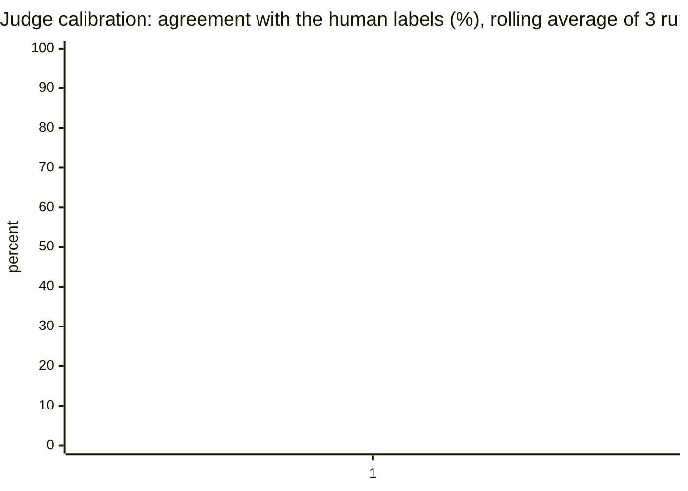

# Eval history

Generated by `code-check eval --history` from `eval-history.jsonl`; do not edit by hand. Each full
`eval --live` or `eval --calibrate` run appends one line to that file and rewrites this one, and the
developer commits both. Runs limited with `--only` are kept in the file but left out here. Live
results vary from run to run, so read the rolling line (the second one) and not a single point, and
check the models column before putting a change down to a prompt. The judge score measures the judge
against the human labels, not the reviewers: it moves when the judge or the labels change.

## Live eval: snippets passed

```mermaid
xychart-beta
    title "Live eval: snippets passed (%), rolling average of 3 runs"
    x-axis [1]
    y-axis "percent" 0 --> 100
    line [100]
    line [100]
```

| # | date | commit | branch | score | outcome | models | cost |
|---|---|---|---|---|---|---|---|
| 1 | 2026-11-16 | f30f0fc+dirty | main | 100% | 5/5 | reviewers sonnet, aggregator opus | $1.95 |

## Judge calibration: agreement with the human labels



| # | date | commit | branch | score | outcome | models | cost |
|---|---|---|---|---|---|---|---|
| 1 | 2026-11-18 | 9f0108f+dirty | feat/gitlab-provider | 50% | 7/14, kappa -0.32 | judge opus | $1.05 |
