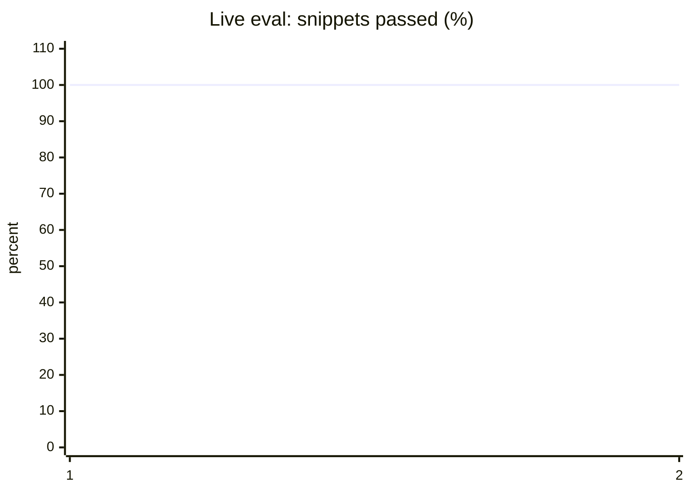

# Eval history

Generated by `code-check eval --history` from `eval-history.jsonl`; do not edit by hand. Each full
`eval --live` or `eval --calibrate` run appends one line to that file and rewrites this one, and the
developer commits both. Runs limited with `--only` are kept in the file but left out here. Live
results vary from run to run, so read the rolling line (the second one, when drawn) and not a single
point, and check the models column before putting a change down to a prompt. The rolling line is left
out while it would sit exactly on the run line, and a chart needs two runs. The judge score measures
the judge against the human labels, not the reviewers: it moves when the judge or the labels change.

## Live eval: snippets passed

| # | date | commit | branch | score | outcome | models | cost |
|---|---|---|---|---|---|---|---|
| 2 | 2026-11-18 | 7bc9da7 | fix/gitlab-sandbox-review-comments | 100% | 5/5 | reviewers sonnet, aggregator opus | $1.93 |
| 1 | 2026-11-16 | f30f0fc+dirty | main | 100% | 5/5 | reviewers sonnet, aggregator opus | $1.95 |

## Judge calibration: agreement with the human labels

The chart appears once there are two runs.

| # | date | commit | branch | score | outcome | models | cost |
|---|---|---|---|---|---|---|---|
| 1 | 2026-11-18 | 9f0108f+dirty | feat/gitlab-provider | 50% | 7/14, kappa -0.32 | judge opus | $1.05 |
